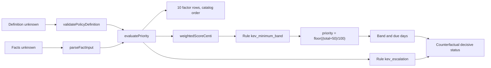

# ADR 0045: Deterministic P1-P4 priority policy and pure policy engine

- Status: Accepted
- Date: 2026-11-02
- Accepted on: 2026-11-04
- Deciders: PatchPilot maintainers (principal architect approval of all 21 checklist
  items recorded on 2026-11-04)
- Supersedes: none
- Superseded by: none

Accepted. The principal architect approved every item in the approval checklist
below on 2026-11-04. This ADR decides the numerical priority policy and the contract
of the pure engine in `packages/policy-engine`. It does not compose the engine, and
acceptance does not authorize production composition. Composition stays blocked by
operator weight validation ([risk register](../security/risk-register.md) R13) and
needs a separate ADR. The decision itself adds no permission, domain port,
PostgreSQL adapter, seed, route, web UI, worker, queue, scheduler, Outbox row,
migration, or dependency. It writes no **RiskCalculation**, sets no
`Finding.currentRiskCalculationId`, and never sets `Finding.dueAt`. Prioritization
stays unavailable. The frozen migration count was 26 when this ADR was proposed. That
count is historical; see the implementation status below.

## Implementation status

Status note dated 2026-11-04. Status is **Accepted** on 2026-11-04. The proposal
date remains 2026-11-02. This note records repository truth at acceptance. It
changes no numerical value, no section 1 to 10 contract, and no checklist item.
Current checkpoint: [current-state.md](../project/current-state.md).

- **Migration count.** The context section and the paragraph above cite 26. That is
  the historical count at proposal. The current frozen migration count is 27.
  Migration 27 belongs to [ADR 0046](0046-offline-npm-osv-import.md). Neither this
  ADR nor its implementation adds a migration.
- **Engine.** Implemented in `packages/policy-engine` with the section 10 golden,
  property, determinism, and package-boundary tests. `POLICY_ENGINE_VERSION` is
  `@patchpilot/policy-engine@1`. The package has zero runtime dependencies.
- **Persistence slice.** Implemented and production uncomposed. The context section's
  statements that no domain port, adapter, or seed exists are historical. The slice
  contains the v2 document types (`RiskPolicyDefinitionV2Json`,
  `RiskCalculationFactorsV2Json`), `PriorityEnginePort`,
  `createCalculateFindingRiskUseCase`, `createReadCurrentFindingRiskUseCase`, the
  PostgreSQL adapter in `packages/database/src/risk-calculation-persistence.ts`, the
  permissions `priority:calculate_controlled` (owner only) and `priority:inspect`
  (owner and admin), and one `priority.calculated` audit row per new calculation.
  `PRIORITY_CONTROLLED_PRODUCTION_REGISTRATION` is `absent`. API, web, worker, and
  migration startup do not construct the use case. The uncomposed writer can append
  **RiskCalculation** rows in tests and development. Production writes none.
- **Built-in version (checklist item 19).** The persistence session chose version 2.
  Builtin `patchpilot.builtin.v0` version 2 has the fixed id
  `55555555-5555-4555-8555-555555555502` and stores
  `BUILTIN_PRIORITY_POLICY_DEFINITION`. Only the development seed publishes it.
  Production seeding is refused, and the production bootstrap writes nothing. No
  production publication path exists.
- **Input fingerprint.** The implementation matches section 9:
  `inputFingerprint` is the SHA-256 of `canonicalJson` of
  `{ engineVersion, policyDefinitionSha256, facts }`, where `facts` is the parsed
  engine fact input. The calculation reason, `sources`, and ingestion ids are not part
  of it. Replay uniqueness is `risk_calculation_replay_key`
  `(organization_id, finding_id, input_fingerprint)`. This is the only RiskCalculation
  idempotency key (risk register R37).
- **Current calculation (checklist item 21).** Resolved by read-time derivation. The
  current calculation is the latest row by `calculated_at DESC, id DESC`.
  `current_risk_calculation_id` and `due_at` stay null. No forward-only migration was
  needed.
- **Sequencing (checklist item 20).** Moot. The [ADR 0044](0044-deliberate-product-match-evidence-evaluation.md)
  implementation the item names merged before acceptance.
- **Composition root.** The last sentence of section 9 and the original follow-up
  repeat ADR 0012's earlier statement that the worker injects the engine. Acceptance
  of this ADR does not choose a composition root.
  [ADR 0047](0047-controlled-priority-activation.md) (Proposed) is that choice:
  deliberate calculation in the API process, and a deployment-local builtin
  publication command. It is not accepted and it authorizes no route. See the
  follow-up section.

## Context

[ADR 0012](0012-explainable-policy-engine.md) accepts a deterministic engine in
`packages/policy-engine` with no I/O and no import of `packages/domain`. Domain
defines a port. [ADR 0047](0047-controlled-priority-activation.md) (Proposed) places
deliberate calculation in the API process and reserves worker injection for a
future automatic-recalculation ADR. That ADR is not composed. Each **RiskCalculation** stores
the policy version, `policyDefinitionSha256`, `inputFingerprint`, contributing
factors, intel source record ids, **priority**, **priorityBand**, due-date
recommendation, and escalation recommendation. ADR 0012 does not decide numbers.

Repository truth at the start of this decision (`main` at the merge of pull request
#98), checked against committed code, the frozen schema, and the frozen migrations:

- **Frozen schema.**
  - `risk_policy.definition`, `risk_calculation.factors`, and
    `risk_calculation.result` are JSONB. Their only CHECK is "object with a
    `schemaVersion` key". `policy_schema_version >= 1`.
  - `policy_definition_sha256` and `input_fingerprint` must match
    `^[a-f0-9]{64}$`. `calculation_engine_version` is `VARCHAR(64)`.
  - `risk_calculation_replay_key` is unique on
    `(organization_id, finding_id, input_fingerprint)`.
  - Published policies are immutable and undeletable. Calculations are append-only.
  - Asset vocabularies are closed enums: `EnvironmentSensitivityClass`
    (`production`, `non_production`), `BusinessCriticality` (`critical`, `high`,
    `medium`, `low`, `unspecified`), `InternetExposure` (`internet_facing`,
    `internal`, `unknown`), and `AssetDataClassification` (`restricted`,
    `confidential`, `internal`, `public`, `unspecified`).
    `ComponentOccurrence.isDirect` is Boolean or null. `VulnerabilityStatus` is
    `active` or `withdrawn`. `Asset.environmentId` is nullable.
  - `finding_creation_initial_state_chk` forces `current_risk_calculation_id IS NULL`
    and `due_at IS NULL` on insert. `patchpilot_finding_reject_update` rejects any
    change to `current_risk_calculation_id` or `due_at`.
- **Accepted ADRs.**
  - [ADR 0011](0011-cisa-kev-enrichment.md): KEV is enrichment, not priority by
    itself. No CVE means no KEV match.
  - [ADR 0017](0017-optional-ai-user-credentials.md): AI never sets priority.
  - [ADR 0023](0023-provider-neutral-cve-identity.md) (Batch 5B): KEV membership is
    `unavailable`, `absent`, or `listedInActiveKev`, with freshness `current`,
    `stale`, or `disabled_with_history`. "A future risk or Finding workflow must
    explicitly decide whether stale or disabled-with-history absence is usable."
  - [ADR 0026](0026-authoritative-match-evidence-and-finding-lifecycle.md) section 23:
    KEV and OSV dates never populate `Finding.dueAt`. Due-date recommendations belong
    on **RiskCalculation**. Section 24: KEV "may later become a versioned risk factor
    if separately approved". Section 25: no hard-coded KEV or OSV score, stale or
    disabled KEV membership needs an explicit policy, and `indeterminate` and
    `unsupported` do not mean low risk.
  - [ADR 0030](0030-first-ecosystem-matching-architecture.md) (Proposed) supplies the
    closed explanation-code precedent, with codes emitted in catalog order.
  - ADRs 0035 to 0044 add no scoring authority.
- **Tested contracts.** `packages/domain/src/json-documents.ts` defines v1
  `RiskPolicyDefinitionJson` (`policyKey`, `factorCatalog`, `weights`),
  `RiskCalculationFactorsJson` (`inputKind` `observed` or `unavailable`, `rawValue`,
  `contribution`, `notes`), and `RiskCalculationResultJson` (`priority`,
  `priorityBand`, `dueDateRecommendationDays`, `escalationRecommendation`). The
  development seed publishes builtin `patchpilot.builtin.v0` version 1 with an empty
  `factorCatalog` and empty `weights`.
- **Checkpoint.** [Current state](../project/current-state.md) says
  `packages/policy-engine` has no scoring implementation and Prioritization is
  unavailable. Its next slice is the [ADR 0044](0044-deliberate-product-match-evidence-evaluation.md)
  implementation.
- **Architecture.** The thresholds, due days, and contributions in
  [risk policy](../architecture/risk-policy.md) are explicitly illustrative.
  [OD-7](../architecture/open-decisions.md) keeps **priority** and **risk score** as
  synonyms.
- **Vocabulary.** The [risk register](../security/risk-register.md) uses P0 to P3 as
  an engineering-risk scale. Product priority bands are P1 to P4 only.

## Decision

PatchPilot adopts one **hybrid** priority model, implemented as a pure,
dependency-free, clock-free engine in `packages/policy-engine`:

- A weighted additive score computed in integer **centipoints**.
- Exactly two closed precedence rules, `kev_minimum_band` and `kev_escalation`. They
  are data in the policy definition and organization overrides cannot change them.
- Nothing else overrides the score. A withdrawn advisory is an informational flag.
  Missing fix, unknown context, and unavailable evidence contribute 0. No input ever
  produces a negative contribution.

This ADR is the separate approval that ADR 0026 section 24 requires for KEV as a
versioned risk factor. KEV enters only through the versioned definition. The engine
code contains no hard-coded KEV or OSV score.

If the diagram is not rendered: the definition and facts are validated separately,
the engine emits 10 factor rows and a weighted score, the KEV floor rule may add an
uplift, the total is rounded once into a priority and band, the escalation rule is
evaluated, and finally each factor's decisive status is computed by counterfactual.

### 1. Vocabulary

- **Factor state.** `observed` means a closed value is present. `unknown` means the
  source explicitly records unknown or unspecified, or KEV absence is relative to a
  non-current catalog. `unavailable` means there is no evidence. `unknown` and
  `unavailable` both contribute 0 and differ only in state and explanation code.
- **Tokens are closed strings, not Booleans**, so a stored value is self-describing:
  `direct` or `transitive`; `available` or `not_available`; `withdrawn` or
  `not_withdrawn` (the ADR 0031 vocabulary).
- **Bands.** `P1`, `P2`, `P3`, `P4`. `P0` is rejected everywhere.
- **Priority.** An integer from 0 to 100. Synonymous with risk score (OD-7).
- **Unit.** One centipoint is 1/100 of a priority point. Weights are integer points,
  normalized values are integer percents, and a contribution in centipoints is
  weight times percent.
- **Factor status.** `decisive`, `contributing`, `non_contributing`, or
  `informational` (section 7).
- **Engine identifiers.** `POLICY_ENGINE_VERSION = "@patchpilot/policy-engine@1"`
  (fits `calculation_engine_version`). `engineContract =
  "patchpilot.priority.p1p4/1"`.

### 2. Input contract

The fact input is a plain object with **exactly** the 10 catalog keys. Each value is
a factor object with `state` and, depending on the factor and state, one of
`value`, `values`, or `reason`.

- An omitted key, an extra key (including `compensating_control` or any remediation
  task field), or an extra property inside a factor object is invalid.
- Invalid input rejects the whole evaluation with `invalid_fact_input` and closed
  issue codes, ordered by catalog ordinal and then issue code. Values are never
  echoed. There is no partial result.

Factors in catalog order:

| Ordinal | Factor | Observed | Unknown | Unavailable |
| --- | --- | --- | --- | --- |
| 1 | `source_severity` | `values`: 1 to 16 ratings from `critical`, `high`, `medium`, `low`, `none` | `value: "unrated"` (source records exist, none maps to a rating) | No source record |
| 2 | `kev_listed` | `listed_catalog_current`, `listed_catalog_stale`, `listed_catalog_disabled_with_history`, `not_listed_catalog_current` | `absent_catalog_stale`, `absent_catalog_disabled_with_history` | `reason`: `no_canonical_cve` or `no_active_generation` |
| 3 | `environment_sensitivity` | `production`, `non_production` | Not accepted (column is non-null) | Asset has no environment |
| 4 | `internet_exposure` | `internet_facing`, `internal` | `unknown` (schema default) | Accepted |
| 5 | `business_criticality` | `critical`, `high`, `medium`, `low` | `unspecified` | Accepted |
| 6 | `asset_data_classification` | `restricted`, `confidential`, `internal`, `public` | `unspecified` | Accepted |
| 7 | `direct_dependency` | `direct`, `transitive` | Not accepted | `isDirect` is null |
| 8 | `fix_available` | `available` (matched interval closes with `fixed`), `not_available` (open-ended interval) | `undetermined` (closed only by `last_affected`) | Accepted |
| 9 | `finding_age_days` | Integer 0 to 36500 | Not accepted | Accepted |
| 10 | `advisory_withdrawn` | `withdrawn`, `not_withdrawn` | Not accepted | Accepted |

Binding rules for callers (normative for the later persistence session; the engine
never receives raw labels or raw catalog data):

- **Severity aggregation** happens inside the engine under the versioned policy: the
  highest rating wins. Every source record stays in calculation provenance, so
  conflicting sources are retained and the winner is chosen only by this versioned
  rule.
- **Severity mapping.** CVSS base score to the FIRST qualitative scale: 0.0 `none`,
  0.1 to 3.9 `low`, 4.0 to 6.9 `medium`, 7.0 to 8.9 `high`, 9.0 to 10.0 `critical`.
  Provider labels: `CRITICAL` to `critical`, `HIGH` to `high`, `MODERATE` or
  `MEDIUM` to `medium`, `LOW` to `low`. Any other label is `unrated`.
- **KEV aggregation** is done by the caller across the bounded linked canonical CVEs:
  any `listedInActiveKev` gives the matching `listed_catalog_*` token; every CVE
  `absent` with freshness `current` gives `not_listed_catalog_current`; otherwise,
  with nothing listed and at least one absence relative to a non-current catalog, the
  factor is `unknown`. `kevDueDate`, `requiredAction`, and ransomware text are never
  inputs.
- **Direct dependency** comes from the occurrence on the creation evidence link or the
  latest legal observation. It cannot come from `Finding.componentOccurrenceId`,
  which is always NULL.
- **Age** is `floor((asOf - firstObservedAt) / 86400000)` using database time.
  Negative, fractional, non-number, and out-of-range values are invalid.
- **Affectedness is not a factor.** The caller invokes the engine only for an
  existing Finding. The engine never infers affectedness.

### 3. Numerical policy

**Formula.**

- `contributionCenti_i = weight_i * percent_i`, where `percent_i` is 0 unless the
  factor is `observed`.
- `weightedScoreCenti = sum(contributionCenti_i)`, in 0 to 10000.
- `upliftCenti = kevListed ? max(0, minPriority(kevMinimumBand) * 100 -
  weightedScoreCenti) : 0`.
- `priority = floor((weightedScoreCenti + upliftCenti + 50) / 100)`. Integer half-up
  rounding, applied exactly once.
- The weight sum of 100 bounds priority to 0 to 100 by construction. The engine
  **rejects rather than clamps**: an out-of-range value is an
  `engine_invariant_violation`, unreachable with a validated definition. The sketch's
  "capped" behavior is not adopted.

**Weights** (points, sum exactly 100):

| Factor | Weight |
| --- | --- |
| `source_severity` | 40 |
| `kev_listed` | 20 |
| `environment_sensitivity` | 10 |
| `internet_exposure` | 10 |
| `business_criticality` | 8 |
| `asset_data_classification` | 5 |
| `direct_dependency` | 3 |
| `fix_available` | 2 |
| `finding_age_days` | 2 |
| `advisory_withdrawn` | 0 (fixed; informational) |

**Normalization** (integer percent). The most favorable observed value is always 0.
`unknown` and `unavailable` are always 0.

| Factor | Percent by token |
| --- | --- |
| `source_severity` | `critical` 100, `high` 75, `medium` 50, `low` 25, `none` 0 |
| `kev_listed` | each `listed_catalog_*` 100, `not_listed_catalog_current` 0 |
| `environment_sensitivity` | `production` 100, `non_production` 0 |
| `internet_exposure` | `internet_facing` 100, `internal` 0 |
| `business_criticality` | `critical` 100, `high` 50, `medium` 25, `low` 0 |
| `asset_data_classification` | `restricted` 100, `confidential` 60, `internal` 20, `public` 0 |
| `direct_dependency` | `direct` 100, `transitive` 0 |
| `fix_available` | `available` 100, `not_available` 0 |
| `finding_age_days` | 0 to 29 days 0, 30 to 89 days 50, 90 days or more 100 |

`fix_available` raises priority because a fix makes the Finding actionable. It is
never a risk reduction, and its absence lowers nothing.

**Bands and due-date recommendations**, computed from the rounded priority:

| Band | Priority | Due-date recommendation |
| --- | --- | --- |
| P1 | 80 to 100 | 7 days |
| P2 | 60 to 79 | 30 days |
| P3 | 40 to 59 | 90 days |
| P4 | 0 to 39 | 180 days |

Due days are calendar-day recommendations, not an SLA. The engine has no clock, so an
absolute date is a caller concern. The recommendation is stored on
**RiskCalculation** and never writes `Finding.dueAt` (ADR 0026 section 23).

**Missing evidence** contributes exactly 0, equal to the factor's most favorable
observed value and never below it. **All evidence unavailable** gives priority 0,
P4, 180 days, and no escalation, with every weighted row `non_contributing` and
`evidenceSummary` of observed 0, unknown 0, unavailable 10. There is no
evidence-insufficiency floor.

### 4. Precedence and exceptional rules

Evaluation order: validation, weighted rows, `kev_minimum_band`, rounding and band,
`kev_escalation`, then decisive status.

1. **Validation first.** An invalid definition or invalid facts produce a closed
   error and no result.
2. **`kev_minimum_band` = P2.** When KEV is listed at any freshness, the engine raises
   priority to at least 60. The uplift is recorded as `upliftCenti` on the rule row,
   so contributions plus uplift equal the total exactly. The rule never promotes
   beyond P2; P1 requires the weighted score. It is labeled catalog enrichment and
   does not claim exploitation or affectedness.
3. **`kev_escalation`.** Recommended when KEV is listed and either
   `environment_sensitivity` is observed `production` or `internet_exposure` is
   observed `internet_facing`. Reasons are emitted in fixed order: `kev_production`,
   `kev_internet_facing`. Unknown or unavailable context never triggers escalation;
   the rule row then carries `kev_escalation_context_not_observed`. Escalation never
   changes the score, band, or due date, and it is not an automatic notification.
4. **Withdrawn advisory.** Informational only. It forces no output and reduces
   nothing. The row carries `advisory_withdrawn_review_required`. ADR 0026 treats
   withdrawal as intelligence, not asset evidence, and forbids automatic resolution,
   and a withdrawn advisory can still be KEV listed; demoting it would hide a listed
   CVE.
5. **KEV freshness.** This is the explicit decision ADR 0023 and ADR 0026 section 25
   require.
   - Absence relative to a current catalog is `observed`
     `not_listed_catalog_current`.
   - Absence relative to a `stale` or `disabled_with_history` catalog is `unknown`.
   - No canonical CVE or no active generation is `unavailable`.
   - A `stale` or `disabled_with_history` **listing** still counts as listed. A
     listing is an affirmative catalog fact removed only by a later accepted
     snapshot.
   - All three non-listed states contribute 0 and differ only in state and code.
6. **No fix** changes only the explanation code (`fix_not_available` or
   `fix_undetermined`).
7. **Unknown asset context never lowers priority** below the factor's most favorable
   observed value. This is a required property test.
8. **Contradictions** are unrepresentable in the closed per-factor union, and
   non-conforming input is rejected whole. Every cross-factor combination is legal;
   withdrawn plus KEV listed is valid. The only multi-source conflict, severity, is
   resolved by the versioned highest-rating rule.
9. **Not engine inputs:** manual override, risk acceptance, compensating controls,
   remediation task state, and AI. This keeps the ADR 0012 rule that the default
   policy does not score compensating-control prose or task completion.

### 5. Ordering and tie-breaking

- **Factor rows** use fixed catalog ordinals 1 to 10 regardless of input key order.
- **Rule rows** are `kev_minimum_band` then `kev_escalation`. Escalation reasons use
  the fixed order in section 4.
- **Contribution view.** `rankFactorsByContribution` sorts by `contributionCenti`
  descending, then ordinal ascending. It is presentation only. Stored rows stay in
  catalog order.
- **Remediation queue.** `compareForRemediationQueue(a, b)` returns `incomparable`
  when `policyKey` differs. The caller must also require an equal
  `policyDefinitionSha256`. Keys, in order:
  1. `priority` descending (subsumes band)
  2. `escalation.recommended` true first
  3. KEV listed first
  4. `source_severity` normalized percent descending
  5. Caller only: `Finding.firstObservedAt` ascending
  6. Caller only: `Finding.id` ascending, as a lowercase canonical UUID compared
     bytewise
- The Finding identifier never enters the engine, its input, or its result. The
  result fields for keys 1 to 4 are present in every evaluation.

### 6. Explainability contract

Every evaluation emits exactly 10 factor rows:

| Field | Meaning |
| --- | --- |
| `factorId` | Closed catalog identifier |
| `ordinal` | Integer 1 to 10 |
| `inputState` | `observed`, `unknown`, or `unavailable` |
| `observedValue` | Closed token, integer, or null. Severity carries the aggregated rating; age carries integer days |
| `normalizedPercent` | Integer 0 to 100 |
| `weight` | Integer points |
| `contributionCenti` | Integer |
| `status` | Section 7 |
| `explanationCode` | Closed code |

Exactly two rule rows: `{ ruleId, triggered, upliftCenti, explanationCode }`.

The result carries `engineVersion`, `policyKey`, `weightedScoreCenti`,
`upliftCenti`, `priority`, `priorityBand`, `dueDateRecommendationDays`,
`escalation { recommended, reasons[] }`, `factors`, `rules`, and
`evidenceSummary { observed, unknown, unavailable }`. The whole result is
deep-frozen.

**Closed explanation codes** are a deterministic function of factor, state, and
token:

- Severity: `severity_{critical,high,medium,low,none}`, `severity_unrated`,
  `severity_unavailable`.
- KEV: `kev_listed_catalog_{current,stale,disabled_with_history}`,
  `kev_not_listed_catalog_current`,
  `kev_absent_catalog_{stale,disabled_with_history}`,
  `kev_unavailable_{no_canonical_cve,no_active_generation}`.
- Environment: `environment_{production,non_production,unavailable}`.
- Exposure: `exposure_{internet_facing,internal,unknown,unavailable}`.
- Criticality: `criticality_{critical,high,medium,low,unspecified,unavailable}`.
- Data classification:
  `data_{restricted,confidential,internal,public,unspecified,unavailable}`.
- Dependency: `dependency_{direct,transitive,unavailable}`.
- Fix: `fix_{available,not_available,undetermined,unavailable}`.
- Age: `age_{under_30_days,30_to_89_days,90_days_or_more,unavailable}`.
- Withdrawal: `advisory_withdrawn_review_required`, `advisory_not_withdrawn`,
  `advisory_withdrawal_unavailable`.
- Rules: `kev_minimum_band_{raised,already_met,not_triggered}`,
  `kev_escalation_{recommended,context_not_observed,not_triggered}`.

Codes are per row only. A separate top-level reason vocabulary is not adopted,
because every review signal is derivable from the rows. Human-readable text is a
static, frozen `EXPLANATION_TEXT` map keyed by code with no interpolation. Only codes
are persisted. The v1 `notes: string` field is not used, because it could carry
tenant text.

The result never contains Finding, asset, component, or user identifiers or names,
compensating-control text, remediation content, KEV prose, or secrets.

### 7. Decisive status

A factor row's status is the first of these that applies:

1. `decisive`: replacing this factor with `unavailable` and re-evaluating, including
   both rules, changes `priorityBand` or `escalation.recommended`.
2. `informational`: the weight is 0.
3. `contributing`: `contributionCenti` is above 0.
4. `non_contributing`: otherwise.

### 8. Policy definition and override boundaries

**Definition document (`schemaVersion: 2`).** Fields: `schemaVersion`, `policyKey`,
`engineContract`, `factorCatalog` (ordered `{ factorId, description }`), `weights`
(all 10 keys), `normalization` (token-to-percent maps and age buckets as
`[{ minDays, percent }]`), `bands` (`[{ band, minPriority,
dueDateRecommendationDays }]` for P1 to P4), and
`rules: { kevMinimumBand: "P2", kevEscalation:
"listed_and_production_or_internet_facing" }`. The policy version is **not**
embedded. It stays the `RiskPolicy.version` column, so the definition hash is
independent of the version number.

**Engine code owns:** the factor catalog, token sets, per-factor state acceptance,
explanation codes and texts, integer arithmetic, half-up rounding, zero for unknown
and unavailable, counterfactual decisive logic, ordering, validation, override
bounds, and a `canonicalJson` serializer (sorted keys, no whitespace). Hashing
happens in the caller.

**Definition validation.** Any failure gives `invalid_policy_definition` with closed
issue codes:

- Exact key sets and exact catalog order.
- Integer weights from 0 to 100 that sum to 100, with `advisory_withdrawn` at 0.
- Exact token sets with integer percents 0 to 100, non-increasing in token order,
  and the favorable extreme at 0.
- Age buckets start at 0, increase strictly, and have non-decreasing percents.
- Band thresholds strictly descending, with P4 at 0. Due days are integers from 1 to
  3650, non-decreasing from P1 to P4.
- `kevMinimumBand` is one of P1 to P4.
- `engineContract` equals the engine's contract.
- No NaN, Infinity, or unexpected keys.

**Built-in definition.** The engine exports a deep-frozen
`BUILTIN_PRIORITY_POLICY_DEFINITION` with `policyKey` `patchpilot.builtin.v0` that
carries exactly the numbers in this ADR.

**Organization override.** Tenant owned, validated by
`validatePolicyOverride(parent, candidate)`:

- Only `weights` may differ from the parent. Every other field, including catalog
  descriptions, must deep-equal the parent, so no tenant free text enters a
  definition. The weight sum stays 100.
- Weight bounds:

| Factor | Allowed weight |
| --- | --- |
| `source_severity` | 30 to 50 |
| `kev_listed` | 10 to 30 |
| `environment_sensitivity` | 0 to 20 |
| `internet_exposure` | 0 to 20 |
| `business_criticality` | 0 to 15 |
| `asset_data_classification` | 0 to 10 |
| `direct_dependency` | 0 to 5 |
| `fix_available` | 0 to 5 |
| `finding_age_days` | 0 to 5 |
| `advisory_withdrawn` | 0 (fixed) |

- **Not overridable:** the catalog, tokens, normalization, age buckets, thresholds,
  due days, both rules, withdrawn handling, zero for missing evidence, rounding,
  ordering, validation, and the bounds themselves.

### 9. Persistence shapes reserved for the persistence session

No schema or migration change. The existing JSONB CHECKs accept these documents.

- **Policy definition v2** is a TypeScript-only superset of v1
  `RiskPolicyDefinitionJson`. `policy_schema_version` becomes 2.
- **Factors document v2**: `{ schemaVersion: 2, factors, rules, evidenceSummary,
  weightedScoreCenti, upliftCenti, sources }`. `sources` carries intelligence source
  record ids, the KEV catalog version and release time, and the occurrence or
  advisory revision ids. The engine never sees `sources`. Mapping from v1:
  `inputKind` becomes `inputState`, `rawValue` becomes `observedValue`,
  `contribution` becomes `contributionCenti`, and `notes` is replaced by
  `explanationCode`.
- **Result document v1** is kept unchanged: `priority`, `priorityBand` (P1 to P4),
  `dueDateRecommendationDays`, and Boolean `escalationRecommendation`. Escalation
  reasons live in the factors document.
- **Columns.** `calculationEngineVersion` is `POLICY_ENGINE_VERSION`.
  `policyDefinitionSha256` is the SHA-256 of `canonicalJson(definition)`.
  `inputFingerprint` is the SHA-256 of canonical `{ engineVersion,
  policyDefinitionSha256, facts }`. It must include the policy hash, or a
  `policy_change` recalculation with unchanged facts would collide with
  `risk_calculation_replay_key`.
- **Built-in seed.** The development seed's v1 placeholder (`patchpilot.builtin.v0`
  version 1, empty catalog and weights) fails v2 validation by design. The
  persistence session keeps the key, chooses the version, and inserts exactly
  `BUILTIN_PRIORITY_POLICY_DEFINITION` in canonical JSON with
  `policy_schema_version = 2`.
- **Current calculation.** `current_risk_calculation_id` is forced NULL by
  `finding_creation_initial_state_chk` and `patchpilot_finding_reject_update`. The
  persistence session must either derive "current" at read time as the latest
  calculation by `calculatedAt` then `id`, or propose a forward-only migration.

The engine defines its own types. A later domain port is structurally compatible.
[ADR 0047](0047-controlled-priority-activation.md) (Proposed) places deliberate
calculation in the API process and amends
[ADR 0012](0012-explainable-policy-engine.md). This ADR does not compose it.

### 10. Required tests for the engine implementation

The implementation must ship a golden matrix covering, at minimum: every band
boundary (60, 59, 40, 39, 79, 80, 100); single half-up rounding across a band edge
under a valid override; every KEV state including the floor raise and floor
`already_met`; both escalation reasons and `context_not_observed`; withdrawn,
not withdrawn, and unavailable withdrawal; every fix state; every token of every
factor; severity aggregation under permutation; all-unavailable input; invalid
definitions (including the v1 dev-seed shape, weight sums of 99 and 101, a `P0`
band, a non-zero withdrawn weight, and an `engineContract` mismatch); invalid facts
(including `compensating_control` and remediation fields, environment `unknown`,
and out-of-range age); override bounds; ordering keys and `incomparable`; and the
explanation catalog. Property tests: replacing unknown or unavailable with any
observed token never lowers priority; a higher-percent token never lowers priority;
contributions plus uplift equal the total and priority equals
`floor((total + 50) / 100)`. Determinism tests: repeated evaluations are deep-equal
with byte-identical canonical JSON; key order does not matter; evaluation succeeds
with `Date`, `Date.now`, and `Math.random` stubbed to throw; inputs are not mutated;
the result is deep-frozen. A package-boundary test proves zero runtime dependencies
and no `@patchpilot/*` or `node:*` imports.

Reference cases under the built-in policy (all other factors unavailable, KEV
unavailable `no_active_generation`):

| Case | Inputs | Priority | Band | Escalation |
| --- | --- | --- | --- | --- |
| All unavailable | none | 0 | P4 | no |
| Sketch Finding A | `critical`, `listed_catalog_current`, `production`, `internet_facing` | 80 | P1 | `kev_production`, `kev_internet_facing` |
| Sketch Finding B | `critical`, `not_listed_catalog_current`, `production`, exposure `unknown` | 50 | P3 | no |
| KEV floor | `low`, `listed_catalog_current` | 60 (W 3000, U 3000) | P2 | no, `context_not_observed` |
| KEV only | `listed_catalog_current` | 60 (W 2000, U 4000) | P2 | no |
| Withdrawn | Finding A plus `withdrawn` | 80 | P1 | both reasons |

## Alternatives considered

- **Pure precedence rules.** Rejected. Coarse and opaque within a band; two Findings
  in the same band cannot be explained relative to each other.
- **Pure weights with no KEV floor.** Rejected. A KEV-listed Finding with low or
  missing severity would land in P4 and be buried.
- **Withdrawn forces P4 or reduces the score.** Rejected. Withdrawal is intelligence,
  not asset evidence, and a withdrawn advisory may still be KEV listed.
- **Clamping out-of-range scores.** Rejected. Clamping hides definition bugs. The
  weight-sum invariant makes the range exact, and a violation is an error.
- **Floating-point arithmetic.** Rejected. Integer centipoints make replay and
  hashing byte-stable across runtimes.
- **An evidence-insufficiency floor** (for example P3 when severity is not observed).
  Rejected for this version. It would rank Findings on missing data. The
  `severity_unavailable` code and `evidenceSummary` let a later UI surface
  insufficient evidence instead. Reconsider through a new policy version.
- **AI scoring.** Rejected by ADR 0012 and ADR 0017.
- **Free-text `notes` as the explanation.** Rejected. Closed codes cannot carry
  tenant text.
- **Organization overrides of thresholds, rules, or normalization.** Rejected. They
  would make bands and escalation incomparable across tenants and let an override
  disable the KEV floor.

## Consequences

Positive:

- Priority becomes explainable row by row, replayable byte for byte, and comparable
  within one policy definition.
- The KEV freshness decision that ADR 0023 and ADR 0026 deferred is made explicitly.
- No migration, dependency, or infrastructure is added. The existing JSONB columns
  carry the v2 documents.

Negative:

- **Systematic under-prioritization today.** Maintainer-reviewed advisories carry no
  severity, so real Findings without KEV land in P3 or P4 from asset context alone.
  This is honest under the no-floor decision but sharp.
- **Coarse severity.** CVSS 9.0 and 9.8 normalize identically. This avoids a CVSS
  calculator dependency.
- **The KEV P2 floor** can over-rank a low-severity KEV entry. Accepted as
  conservative.
- **Stale listings count as listed** and may over-rank after a CISA removal until the
  next accepted snapshot. Accepted as conservative.
- **Withdrawn is flag-only** and may spend effort on invalid advisories.
- **Escalation requires observed context**, so KEV Findings with unknown context do
  not escalate. The rule code makes that visible.
- **Weights are product proposals, not security truth** (risk register R13). They
  change only through a new policy version.
- **Age buckets** cause recalculation churn at day 30 and day 90 if the caller
  recalculates on a schedule.
- **Weak database JSON CHECKs** leave application validation as the only guard on v2
  documents.

## Security and tenancy

- The engine is tenant free. It receives no organization, Finding, asset, component,
  or user identifier, and it returns none.
- Built-in policies are global. Organization overrides are tenant owned. Loading an
  override only from the authorized organization's published policy is a caller
  obligation. A client-supplied organization identifier is never authorization.
- Overrides cannot introduce free text: every non-weight field must deep-equal the
  parent.
- The engine performs no I/O, no fetch, and no clock or random read. There is no SSRF
  surface. KEV prose, `requiredAction`, and due dates are never inputs.
- Results persist only closed codes, integers, and closed tokens. Nothing in the
  result may be logged beyond the canonical redaction list in
  [security rules](../../.cursor/rules/security.mdc).
- KEV is labeled catalog enrichment. No output claims exploitation, affectedness,
  compliance, or remediation.
- AI never sets priority.
- Calculation and policy publication audit events are a persistence-session
  obligation. `risk_policy.published` is already in the
  [audit model](../architecture/audit-model.md), and priority calculation is on the
  repository's required append-only audit list.

## Operational failure plan

- **Invalid definition or facts.** The engine returns a closed error and no result.
  The caller writes no calculation and records a bounded internal code.
- **Bad policy numbers in a published version.** Operators roll forward by publishing
  a new version and recalculating. Historical calculations are never rewritten.
- **Engine bug.** Fixed by a new `POLICY_ENGINE_VERSION`. Because the engine version
  is in the input fingerprint, recalculation inserts new rows without colliding with
  replay rows.
- **Invariant violation.** `engine_invariant_violation` is unreachable with a
  validated definition. If it occurs, the caller fails closed and writes nothing.

## Follow-up

Amended on 2026-11-04. Completed items are kept for the record.

- Done. Implement the engine in `packages/policy-engine` (catalog, definition and
  override validation, fact parsing, evaluation, ordering, canonical JSON, deep
  freeze, and the built-in definition) with the tests in section 10. Production stays
  uncomposed.
- Done. Persistence session: v2 TypeScript document types, the domain port, the
  built-in seed version (2), the `current_risk_calculation_id` decision (read-time
  derivation), and calculation audit. Production stays uncomposed.
- Replaced. The original persistence item also named "worker composition through the
  transactional Outbox". That item is withdrawn. Production composition, the
  composition root, and production publication of the built-in policy are proposed by
  [ADR 0047](0047-controlled-priority-activation.md). Until that ADR is accepted, no
  composition root is in force. `finding.recalculate`, worker scoring, and automatic
  recalculation stay unauthorized.
- Done. Replace the illustrative sketch in [risk policy](../architecture/risk-policy.md)
  with a reference to this ADR, update the R13 residual in the
  [risk register](../security/risk-register.md), and update
  [current state](../project/current-state.md).
- Open. Operator validation of weights (R13) before any production composition.
  Validation binds to `POLICY_ENGINE_VERSION` and the exact `policyDefinitionSha256`
  of the built-in definition. A change to either needs a new validation. Acceptance of
  this ADR is not that validation.

## Approval checklist

Acceptance requires principal architect approval of each item:

1. The hybrid model with exactly two precedence rules.
2. Weights 40, 20, 10, 10, 8, 5, 3, 2, 2, 0.
3. All normalization tables, with the favorable extreme at 0.
4. Thresholds 80, 60, 40 and due days 7, 30, 90, 180, adopted from the sketch.
5. A KEV minimum band of P2, implemented as an uplift.
6. Escalation extended to observed internet-facing context (the sketch required
   production only).
7. Stale or disabled listing counts as listed; stale or disabled absence is `unknown`.
8. Withdrawn is an informational flag only: no forced output and no reduction.
9. No evidence-insufficiency floor; all-unavailable evidence gives P4.
10. Severity aggregation inside the engine: highest rating, at most 16 values.
11. The normative caller mapping from CVSS and provider labels to ratings.
12. Age buckets at 30 and 90 days and the 36500-day bound.
13. Overrides limited to weights, with the bounds table and the non-overridable list.
14. Rejection instead of clamping, centipoint integer arithmetic, and single half-up
    rounding.
15. The counterfactual definition of `decisive`.
16. Queue keys and the comparator returning `incomparable` across policies.
17. Per-row closed explanation codes with no separate reason vocabulary.
18. v2 policy and factors documents as TypeScript-only types, keeping result v1.
19. The built-in key `patchpilot.builtin.v0`, with the version chosen by the
    persistence session and a hash independent of the version.
20. Confirmation that this ADR and the engine implementation may proceed ahead of the
    checkpoint's named next slice ([ADR 0044](0044-deliberate-product-match-evidence-evaluation.md)
    implementation).
21. The persistence-session obligation to resolve the `current_risk_calculation_id`
    constraint, by read-time derivation or a forward-only migration.

### Approval record

On 2026-11-04 the principal architect approved all 21 items above. The items are
recorded unchanged.

- Items 1 to 18 are approved as written.
- Item 19 is approved as written. The persistence session chose version 2, and the
  definition hash does not depend on the version number.
- Item 20 is approved and recorded as moot. The ADR 0044 implementation it names had
  already merged.
- Item 21 is approved and recorded as resolved by read-time derivation: latest by
  `calculated_at DESC, id DESC`, with no migration.

Approval accepts the policy decision only. It is not operator weight validation (R13),
and it authorizes no production composition, route, worker job, Outbox event, policy
publication, or migration.
