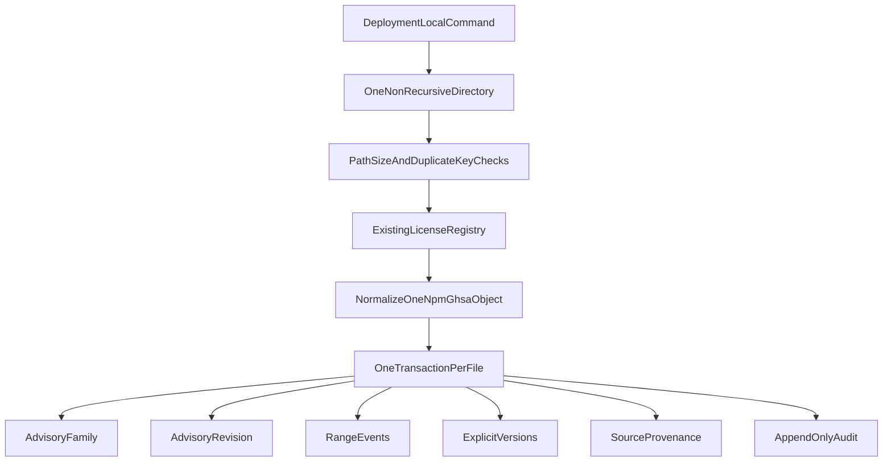

# ADR 0046: Offline npm OSV import

- Status: Proposed
- Date: 2026-11-02
- Deciders: PatchPilot maintainers
- Supersedes: none
- Superseded by: none

Proposed. Acceptance is a maintainer decision on merge. This ADR adds one
operator acquisition mode. It does not supersede
[ADR 0021](0021-vulnerability-intelligence-import-foundation.md),
[ADR 0024](0024-authoritative-affected-version-source-and-osv-acquisition.md),
[ADR 0028](0028-osv-runtime-enablement-architecture-and-safety.md), or
[ADR 0032](0032-maintainer-reviewed-advisory-authority.md). It does not accept
[ADR 0027](0027-osv-acquisition-persistence-and-catalog-activation.md).

The command and script are implemented and production uncomposed. This ADR remains Proposed. Migration 27 is
`packages/database/prisma/migrations/20261102120000_offline_npm_osv_import/migration.sql`.
The frozen migration count is 28. This ADR adds no route, web action, worker job,
seed, Outbox row, Finding, Product Match Evidence row, or RiskCalculation.
Production OSV acquisition stays disabled.

## Context

[ADR 0024](0024-authoritative-affected-version-source-and-osv-acquisition.md)
sections 9 and 10 require a future OSV ingestion to preserve `modified`,
`published` when present, `withdrawn` when present, explicit affected versions,
package PURL when present, and content identity. Section 11 requires bounded
secure JSON parsing. Section 12 requires the selected source license to be the
verified registry entry. Section 13 keeps `INTELLIGENCE_OSV_ENABLED=true`
rejected. Section 18 says a missing provider object is not a withdrawal unless
a complete accepted catalog generation says so. Section 19 leaves ZIP and other
archives unauthorized.

[ADR 0021](0021-vulnerability-intelligence-import-foundation.md) keeps
intelligence instance-owned and forbids silent in-place overwrite. Findings
derived from intelligence stay tenant-owned. This import writes none.

Repository truth at this decision, checked against the frozen schema and the
vulnerability-intelligence contracts:

- `AdvisoryRevision` stores one package. SEMVER events can be stored only as
  `AdvisoryRevisionRangeEvent` rows. Withdrawal is `not_withdrawn` or
  `withdrawn`. License pins are `spdx_license_id` plus
  `source_license_registry_version`. The revision row has no `published_at`,
  `modified_at`, `withdrawn_at`, explicit-version rows, PURL, raw content hash,
  or `retrieved_at`.
- `advisory_revision_range_event_shape_chk` allows range ordinals 0 through 31
  and event ordinals 0 through 15. Event names are `introduced`, `fixed`,
  `last_affected`, and `limit`. Event values are 1 to 256 characters. The
  parser ceilings are higher: 128 ranges per affected entry and 1,024 events
  per range (`OSV_ADVISORY_PARSER_RESOURCE_POLICY_V1_VALUES`).
- `advisory_revision_classification_chk` admits `provider_derived` only with
  `recorded_reference`, a UUID version-4 `retrieval_evidence_id`, and
  `provider_generation` matching `^[1-9][0-9]{0,19}$`. The maintainer branch
  uses `local_not_retrieved` with `local_retrieval_not_applicable` and
  `not_a_provider_generation`. The sentinel `offline-import-v1` fails that
  check.
- `advisory_revision_pin_chk` requires every non-maintainer revision to use
  `revision_schema_version = osv_advisory_revision_identity_v1` and
  `retrieval_policy_id = osv_generation_bound_retrieval_policy_v1`.
- `advisory_revision_author_chk` requires `author_identity` null unless the
  origin is `maintainer_reviewed_advisory`.
- The PostgreSQL enum `AdvisoryRetrievalClassification` already contains
  `local_not_retrieved`. The TypeScript union
  `ADVISORY_RETRIEVAL_CLASSIFICATIONS` in
  `packages/vulnerability-intelligence/src/matching/advisory-revision-persistence/policy.ts`
  does not.
- `parseAdvisoryRevisionCommand` accepts `provider_derived` only with a numeric
  generation and `recorded_reference` plus a UUID.
  `PROVIDER_GENERATION_PATTERN` is `^[1-9][0-9]{0,19}$`. The persisted command
  schema is `osv_advisory_revision_persistence_command_v1`.
  `advisoryRevisionDigest` hashes material whose schema field is
  `osv_advisory_revision_identity_v1`.
- `persistImmutableAdvisoryRevision` re-parses that command and does not insert
  `AdvisoryRevisionRangeEvent` rows. Explicit versions are fingerprint input
  and are not stored as rows.
- Product-evidence composition classifies a `provider_derived` revision whose
  retrieval class is not `recorded_reference` as `malformed_evidence` /
  `malformed_revision`.
- `patchpilot_advisory_revision_supersession` checks family identity. It does
  not check `package_identity_key`.
- License admission for GHSA is the existing registry entry
  `github_advisory_database` in `OSV_SOURCE_LICENSE_REGISTRY`
  (`osv_source_license_registry_v1`): SPDX `CC-BY-4.0`, normalization
  permitted, internal matching permitted. MAL
  (`ossf_malicious_packages`) prohibits internal matching. `osv_ambiguous_origin`
  and `echo_advisory_database` are not retrieval-eligible.
- Parser input ceilings used here are the existing ones: 1,048,576 bytes,
  structural depth 32, and 262,144 UTF-8 bytes per string. Listing-page record
  ceiling `OSV_LISTING_MAX_OBSERVATIONS_PER_PAGE` is 1,000. Schema bytes stay
  on `getOsvSchemaPath()` (`v1.9.0`, commit
  `f3f826310aeca8e324baabd195632f2229952abe`).
- [OD-10](../architecture/open-decisions.md) remains open. The deployment-local
  instance advisory grant command is host execution for grant, revoke, and
  user enablement. It is not a general operator identity.

Putting these bytes through the GCS generation tables, a maintainer approval
row, or `Vulnerability.osvId` would forge source identity. Editing a frozen
migration is forbidden.

## Decision

PatchPilot adopts one deployment-local offline import of npm GHSA OSV JSON
objects into the existing instance advisory model.



If the diagram is not rendered: the operator runs one command against one
directory. Preflight checks paths, sizes, and duplicate JSON keys. The existing
license registry admits the record. One npm GHSA object is normalized. One
database transaction per file writes the family, revisions, range events,
explicit versions, provenance, and one audit event.

### 1. Boundaries

Imported intelligence is instance-owned shared catalog data. It is not proof
that an asset is affected.

This slice writes no Finding, FindingObservation, Product Match Evidence,
match-evaluation evidence, Vulnerability, advisory-vulnerability binding,
maintainer approval, reviewer capability, RiskCalculation, or tenant row. It
does not calculate P1 to P4. An `organizationId` in a document is not authority
and is not stored.

Online OSV synchronization stays outside this slice.
`INTELLIGENCE_OSV_ENABLED=true` stays rejected. `intelligence.osv.sync` stays
unregistered. The command has no flag that enables OSV, contacts a provider, or
fetches a URL. `references` are data. Nothing is fetched.

Later correlation reads the normalized advisory model. It does not read the
import files. A directory is not a complete OSV catalog. A missing file is not
a withdrawal and does not delete a revision.

These rows are not product-evaluation eligible. Composition classifies the
offline shape as ineligible. It does not classify that shape as
`malformed_revision`. Section 8 states the exact shape.

### 2. Command ownership

The command has the same host-execution shape as the instance advisory grant
command. It is not an API route, web action, worker job, seed, or migration.

- Contracts, license preflight, and normalization live in
  `@patchpilot/vulnerability-intelligence`. Those modules accept bytes. They do
  not import `node:fs`, `node:http`, `node:https`, or `node:net`.
- `packages/domain` is unchanged. Domain stays free of Prisma, Fastify, and
  filesystem I/O.
- PostgreSQL writes live in `@patchpilot/database`.
- Process entry:
  `packages/database/src/offline-npm-osv-import-command-main.ts`. It loads the
  database URL through `@patchpilot/config`. It does not read `process.env`.
- Wrapper: `scripts/run-offline-npm-osv-import.mjs`, and a root `package.json`
  script named `offline-npm-osv-import`. The script is not referenced from
  `dev`, `build`, `test`, or `postinstall`. API, web, worker, scheduler, queue,
  seed, and migration startup do not invoke it.
- The wrapper runs `packages/database/dist/offline-npm-osv-import-command-main.js`.
  When that file is absent, stderr is the token
  `offline_npm_osv_import_not_built` and the exit code is 1.

Authority is host execution. This does not close OD-10. Organization roles and
`advisory_submit_local` cannot invoke or control it.

The database setting is the same server configuration as the API, including
`DATABASE_URL`. The command does not print that location and does not accept a
second database setting.

Invocation, once the script exists:

```text
pnpm offline-npm-osv-import -- --directory <directory> --correlation-id <correlation-id>
pnpm offline-npm-osv-import -- help
```

`<correlation-id>` is a canonical lowercase UUID. `help` writes the fixed usage
text to stderr, writes no JSON, and exits 0. Any other flag is
`invalid_command`. A flag that would enable OSV or fetch a URL is
`invalid_command`.

### 3. Accepted input

The directory argument is one host path. The command opens that directory and
does not recurse. It reads one file at a time. It does not follow a symlink.
It opens each file with `O_NOFOLLOW`.

Directory preflight rejects the directory, writes no batch, and exits 3 when
any entry is a symlink, directory, device, fifo, or other non-regular file;
when an entry name is `.`, `..`, empty, longer than 255 bytes, absolute,
contains `/` or `\`, contains `:`, contains a control character, or starts with
`.`; when more than 1,000 entries are present; or when any regular file is
larger than 1,048,576 bytes. An empty directory is a valid run of zero files.

Each admitted file is one regular file and one JSON object. Parser ceilings
apply: depth 32, 262,144 UTF-8 bytes per string, and the other limits in
`OSV_ADVISORY_PARSER_RESOURCE_POLICY_V1_VALUES`. Duplicate keys are rejected
with the existing `jsonHasDuplicateKeys` helper before parse. This command does
not rely on the parser's last-key-wins behavior, and it does not change that
parser constant.

Schema validation uses the pinned Ajv validator. Schema bytes stay on
`getOsvSchemaPath()`. Remote `$ref` and runtime schema download stay rejected.
Schema success is not admission. The normalizer applies the record rules below
after a successful parse.

The in-process parser is the operator tool. The unimplemented parser worker is
not built. `Promise.race` is not a timeout. The 5-second worker budget stays
unenforced. An operator stall on a local file is an accepted risk.

File processing order is code-unit order of the single path segment. Package
revisions inside one file are ordered by package identity key, using the
existing code-unit comparison.

### 4. Record admission

All of the following are required. Failure rejects the file and writes nothing
for that file.

- Top-level `id` is a string. `extractOsvFamilyCandidate` on that id returns
  known family `GHSA`. The id also matches the frozen advisory-id check:
  length 1 to 512 and `^[A-Z0-9][A-Z0-9._+-]*$`. `database_specific.id` is not
  the advisory id. A filename is not the advisory id.
- `getOsvSourceRegistryEntryByFamily('GHSA')` returns
  `github_advisory_database`. Normalization permission is `permitted`. Internal
  matching permission is `permitted`. SPDX is the registry value `CC-BY-4.0`.
  A SPDX string inside the JSON is not consulted. The `npm/` prefix is not a
  license.
- Unknown families, `OSV-` (`osv_ambiguous_origin`), and `ECHO-`
  (`echo_advisory_database`) fail closed. MAL is not admitted: its registry
  entry prohibits internal matching. Any other family fails closed.
- `affected` has one to 1,024 entries. Every `affected[].package.ecosystem` is
  exactly `npm`. A mixed-ecosystem object is rejected as a whole. An empty
  `affected` array is `empty_affectedness`.
- One to many npm packages become one revision each under the same
  `AdvisoryFamily` `(source, advisoryId)`. Family schema stays
  `osv_advisory_family_identity_v1`.
- Package identity uses `classifyNpmPackageIdentityFromParts`. A scoped
  `package.name` of the form `@scope/name` splits on the slash the same way the
  maintainer document splits `packageName`. An unscoped name uses a null
  namespace. `observedIdentity` is the `package.name` string. Two affected
  entries that classify to the same identity key reject the file.
- When `package.purl` is present, `classifyNpmPackageIdentityFromPurl` must be
  valid and its canonical name must equal the name-derived canonical name. A
  PURL version, qualifier, or subpath is not package identity and is not
  copied into explicit versions. The original PURL is stored on provenance
  when it agrees, at most 8,192 bytes. A missing PURL stores null.
- Ranges are `SEMVER` only. `GIT` and `ECOSYSTEM` reject the file. A range
  object that contains a `repo` key is rejected, so that value is not dropped.
  Two ranges with the same event list reject the file. Event names are only
  `introduced`, `fixed`, `last_affected`, and `limit`.
  Durable caps apply: at most 32 ranges (ordinals 0 through 31) and at most 16
  events per range (ordinals 0 through 15). A file the parser accepts and the
  durable caps reject is rejected as a whole. This slice does not widen
  `advisory_revision_range_event_shape_chk`.
- Explicit `versions` are preserved as rows. They are not rejected for being
  present and they are not folded into a `versionRange` string. Each value is
  1 to 256 characters. Duplicate version strings within one package reject the
  file. The count cap is the parser cap of 50,000.
- An affected entry with no SEMVER range and no explicit version is
  `empty_affectedness` and rejects the file.
- `modified` is required. `published` and `withdrawn` are kept when present.
  Each present timestamp parses as an instant and is stored in UTC. The digest
  encoding is `YYYY-MM-DDTHH:mm:ss.sssZ`. A `withdrawn` timestamp sets
  withdrawal classification to `withdrawn` and disposition to `withdrawn`.
  Absence of `withdrawn` sets `not_withdrawn`.
- Aliases use the existing alias parser and `osv_advisory_alias_policy_v1`.
  Alias ordinals stay on the existing code-unit sort. Aliases do not create a
  `Vulnerability` or a binding.
- `summary`, `details`, `severity`, `references`, `credits`, `related`,
  `database_specific`, and `ecosystem_specific` stay unstored.

Trust is `unreviewed`. Quarantine is `not_quarantined`. `author_identity` is
null. A rejected file is not stored as a quarantined revision.

### 5. Normalization and identity

The offline command schema is
`offline_npm_advisory_revision_persistence_command_v1`. The existing revision
parser accepts it only in combination with all of:

- origin `provider_derived`
- source `github_advisory_database`
- retrieval `local_not_retrieved`
- retrieval evidence id `offline_import_retrieval_not_applicable`
- retrieval policy `offline_osv_import_retrieval_policy_v1`
- provider generation `offline-import-v1`
- revision schema `offline_npm_advisory_revision_identity_v1`
- trust `unreviewed`
- SPDX `CC-BY-4.0`

`local_not_retrieved` is added to the TypeScript retrieval union. The GCS
branch still requires numeric `providerGeneration`, `recorded_reference`, and
a UUID version-4 retrieval evidence id. The sentinel fails
`PROVIDER_GENERATION_PATTERN`, so an offline command cannot take the GCS
branch. `advisoryRevisionDigest` stays on
`osv_advisory_revision_identity_v1`. Maintainer command schema
`osv_advisory_revision_persistence_command_v1` is unchanged.

A separate digest function hashes length-prefixed offline material whose
schema field is `offline_npm_advisory_revision_identity_v1`. The material
includes the existing content fingerprint, the session-14 range fingerprint,
the product range fingerprint, the parser and schema pins, the sentinel, the
retrieval token, withdrawal, quarantine, supersession, package identity through
the content fingerprint, normalization identity
`offline_npm_osv_normalization_v1`, canonical `modified`, canonical `published`
or an empty token, canonical `withdrawn` or an empty token, and the raw
SHA-256 of the original file bytes.

`content_fingerprint` remains `productContentFingerprint` of the normalized
fields. `session14RangeFingerprint` is the existing function, so a changed
explicit version or range changes that fingerprint. Range ordinals follow that
function's sort: each range is rendered with source event order, the range
texts are sorted by code unit, and stored `range_ordinal` is 0 through n-1 in
that order. `event_ordinal` stays source order, starting at 0. Explicit-version
ordinals are the code-unit sort of the version strings, starting at 0.

JSON whitespace and object-key order do not change the normalized fields.
They do change the raw file SHA-256. Because that hash is part of the offline
revision digest, a different encoding is a new revision. Exact same bytes and
agreeing normalized fields are `already_applied`.

Same digest and agreeing offline comparison material: `already_applied`, no
second revision, alias, range, version, provenance, or file audit row. Same
digest and disagreeing material: `immutable_conflict`, no write. Changed
normalized identity, including a changed `modified`, range, explicit version,
alias set, withdrawal, package set, or raw byte hash, inserts a new revision
under the existing family.

Parser pins stored on the revision are the existing ones:
`osv_advisory_parser_protocol_v1`,
`osv_advisory_parser_resource_policy_v1`, schema `v1.9.0`, and schema commit
`f3f826310aeca8e324baabd195632f2229952abe`. `evaluator_version` is
`session_14_batch_2_in_memory`. `matching_policy_id` is
`osv_first_ecosystem_matching_architecture_v1`. Those columns are non-null
pins. Recording them does not admit the revision to product evaluation.

### 6. Persistence, transactions, and idempotency

Extend `persistImmutableAdvisoryRevision`'s transaction for the offline
command. Do not add a second advisory writer. Do not insert through maintainer
submission. The GCS command keeps writing zero range rows.

`retrieved_at` is chosen once per run from PostgreSQL `clock_timestamp()` in
the batch transaction and copied onto provenance. It is not the file's
`modified` and not the operator clock.

The manifest is SHA-256 of length-prefixed canonical material: schema
`offline_npm_osv_import_manifest_v1`, then each preflight-admitted file in
code-unit order of its path segment, as path segment, decimal byte length, and
lowercase raw SHA-256. The manifest covers admitted files before JSON
admission, so a deterministic record rejection stays in the same manifest.

One batch row is inserted in its own transaction before any file transaction.
Exact replay of the same manifest is `already_applied`: no second batch row
and no second started audit. A crash after that commit leaves the batch in
place. A re-run replays it.

One transaction per file covers every package revision from that file. The
transaction takes `pg_advisory_xact_lock(hashtextextended('offline-npm-osv:' || source || ':' || advisory_id, 0))`
before it reads the family, so two concurrent imports of the same GHSA cannot
create two tips. Lock order is that advisory lock, then the family row
`FOR UPDATE` when the family already exists.

Supersession is set only to the current tip with the same family and the same
`package_identity_key`. The tip is the revision of that family and package
that no other revision of that same family and package supersedes. Zero tips
insert with `supersedes_revision_digest = none`. One tip is superseded by a
changed digest. Two or more tips are `malformed_persisted_state` and the file
rolls back. A replay of an older digest that already exists does not move the
tip. There is no in-place update and no automatic current-revision pointer.

A failed file rolls back only that file. Earlier files stay committed. There
is no catalog activation, so those commits are visible and are not a generation
switch. The terminal audit is a separate transaction after the files. A crash
before it leaves the batch and any committed revisions in place. A re-run
replays them and, with a new correlation id, writes a new terminal audit.

No network, object storage, or queue I/O runs inside a transaction. No Outbox
row is written.

### 7. Migration 27

Migration 27 is a new file,
`packages/database/prisma/migrations/20261102120000_offline_npm_osv_import/migration.sql`.
Frozen SQL is untouched. The same change updates `FROZEN_MIGRATIONS`, the
migration integration test, [docs/development/migrations.md](../development/migrations.md),
and the checkpoint. The migration file applies it. This ADR text does not contain that SQL.

The migration creates three instance-owned tables. None has `organization_id`.
Update and delete are forbidden by append-only triggers. Foreign keys are
`ON DELETE RESTRICT`.

- `offline_advisory_import_batch`: id, `manifest_sha256` unique, registry id
  `osv_source_license_registry_v1`, `retrieved_at`. No mutable counters.
- `advisory_revision_source_provenance`: one row per revision, unique on
  revision id. Columns cover source, registry id, advisory id, package
  identity key, raw content SHA-256, parser and schema pins, normalization
  identity `offline_npm_osv_normalization_v1`, `retrieved_at`, `modified_at`,
  nullable `published_at`, nullable `withdrawn_at`, nullable PURL, license
  admission reason `approved_source_license`, and batch id.
- `advisory_revision_explicit_version`: `(advisory_revision_id, ordinal)`
  unique, and `(advisory_revision_id, version_text)` unique. `version_text` is
  1 to 256 characters. Ordinals are integers, contiguous from 0, and below
  50,000.

Deferred constraint triggers require, for each offline revision, one
provenance row and contiguous explicit-version ordinals when any version row
exists. A committed offline revision has at least one range row or one
explicit-version row.

The migration replaces `advisory_revision_classification_chk` and
`advisory_revision_pin_chk` forward-only by dropping and recreating them. Every
existing branch stays. One new classification branch admits only:

- origin `provider_derived`
- source `github_advisory_database`
- trust `unreviewed`
- quarantine `not_quarantined`
- SPDX `CC-BY-4.0`
- retrieval `local_not_retrieved`
- retrieval evidence id `offline_import_retrieval_not_applicable`
- provider generation `offline-import-v1`
- `not_withdrawn` with no supersession and disposition `recorded`, or
  `not_withdrawn` with supersession and disposition `superseding`, or
  `withdrawn` with disposition `withdrawn`

One new pin branch admits that same origin and source with revision schema
`offline_npm_advisory_revision_identity_v1`, retrieval policy
`offline_osv_import_retrieval_policy_v1`, the existing parser and OSV schema
pins, registry `osv_source_license_registry_v1`, ecosystem `npm`, evaluator
`session_14_batch_2_in_memory`, and matching policy
`osv_first_ecosystem_matching_architecture_v1`.

A new trigger `patchpilot_advisory_revision_supersession_package` rejects a
successor whose `package_identity_key` differs from the prior revision. The
frozen supersession function is not edited. Same-package successors that
already commit still commit.

### 8. Product-evidence classification

Composition gains eligibility `ineligible_offline_import` and failure code
`local_not_retrieved`. For the offline shape below, composition returns that
pair and stops. It does not call the product evaluator and it does not write a
product match row. The shape is `provider_derived`, source
`github_advisory_database`, retrieval `local_not_retrieved`, generation
`offline-import-v1`, retrieval policy `offline_osv_import_retrieval_policy_v1`,
and revision schema `offline_npm_advisory_revision_identity_v1`.

Any other use of `local_not_retrieved` on a `provider_derived` revision stays
`malformed_evidence` / `malformed_revision`. Maintainer-reviewed revisions keep
their current classification. This slice adds no approval, binding, or
product-evidence guard exception. The existing evidence guard still requires an
approval and a binding, which this import does not write.

### 9. Audit and operator output

Audit uses `AuditEvent` with actor `system`, null user, null organization, and
null membership. Row `schemaVersion` is 1. Payload `schemaVersion` is 1.
Payload fields are counts, reason codes, advisory ids that already passed the
advisory-id grammar, SHA-256, registry id, and byte length. The payload has no
body, URL, path, filename, stack, secret, or document text.

Actions:

| Action | When | Subject |
| --- | --- | --- |
| `intelligence.offline_npm_osv_import_started` | Batch insert transaction | Batch id |
| `intelligence.offline_npm_osv_file_imported` | File transaction that inserts at least one revision | Family id |
| `intelligence.offline_npm_osv_import_completed` | Terminal transaction after the files | Batch id |

Exact batch replay writes no second started event. Full-file replay writes no
second file event. The frozen system audit replay index allows one
`intelligence.offline_npm_osv_file_imported` row for a family and correlation.
A later file in that same correlation that inserts another revision still
commits the revision and does not write a second file audit. A new correlation
id writes its own file audit and a new terminal event. The same
correlation id and the same batch write no second terminal event. The same
correlation id already used for a different batch is `immutable_conflict`
before file processing.

Standard output for a completed attempt is one JSON object of schema
`offline_npm_osv_import_summary_v1`: correlation id, batch id, manifest
SHA-256, registry id, `retrieved_at`, and `accepted`, `skipped`, `rejected`,
and `failed`. `skipped` means `already_applied`. Each group carries a count,
advisory ids when they passed the id grammar, and stable reason codes. Illegal
ids are omitted. The summary has no path and no document text.

| Exit | Meaning |
| --- | --- |
| 0 | Directory accepted and no file outcome is `failed`. Record rejections stay in `rejected`. |
| 1 | A file transaction, the batch transaction, or the terminal transaction failed, or the outcome is uncertain. |
| 3 | The command or the directory was rejected before a file transaction. |
| 7 | The database setting is missing or malformed, or PostgreSQL is unavailable before a commit. |

Failure stderr is one line and one token: `offline_npm_osv_import_directory_rejected`,
`offline_npm_osv_import_failed`, or `offline_npm_osv_import_database_unavailable`.
Success writes no stderr. The command does not retry.

Closed file reason codes include `malformed_json`, `duplicate_keys`,
`schema_rejected`, `identity_rejected`, `ecosystem_rejected`,
`license_rejected`, `empty_affectedness`, `range_rejected`,
`explicit_version_rejected`, `unreadable_file`, `already_applied`,
`immutable_conflict`, `malformed_persisted_state`, `transaction_aborted`, and
`internal_failure`.

### 10. Tests the implementation slice must include

Unit tests in `@patchpilot/vulnerability-intelligence` cover normalization,
license rejection, mixed ecosystems, duplicate keys, digest determinism, and
the source boundary against `osv.dev`, `storage.googleapis.com`, `node:http`,
`node:https`, and `node:net`. Command tests use injected IO. Integration tests
on `createEphemeralDatabase` cover first import, replay, changed `modified`,
explicit versions, range rows, provenance, per-file rollback, zero Findings,
and a client organization id that changes nothing. Documents are synthetic. A
real GHSA body is not copied into the repository.

## Alternatives considered

- Admit only range-only GHSA records and drop `modified`, explicit versions,
  and PURL. That weakens ADR 0024 sections 9 and 10.
- Call the local file a GCS provider generation, or set
  `INTELLIGENCE_OSV_ENABLED=true`. Production OSV acquisition stays disabled,
  and the sentinel must not pass `PROVIDER_GENERATION_PATTERN`.
- Reuse `POST /intelligence/maintainer-reviewed-advisories` or
  `license_decision_canonical` on maintainer approval. That source is
  `maintainer_reviewed_advisory`, not `github_advisory_database`.
- Add a second license allowlist. Admission stays
  `OSV_SOURCE_LICENSE_REGISTRY`.
- Import ZIP, `all.zip`, JSONL, or a JSON array. ADR 0024 leaves archives
  unauthorized. The parser contract is one JSON object
  (`batchParsing: false`).
- Widen the frozen range-event ordinal caps to the parser ceilings in this
  slice. The durable caps stay 32 ranges and 16 events. Overflow rejects the
  file.
- Treat whitespace-only re-encoding as the same revision. The raw file SHA-256
  is part of revision identity, so a different encoding is a new revision.
  Normalized fields still ignore key order and insignificant whitespace.
- Build the unimplemented parser worker, or describe `Promise.race` as the
  5-second timeout. The operator command accepts the stall risk instead.

## Consequences

- Operators can load a bounded npm GHSA directory without enabling production
  OSV acquisition. The rows are visible as soon as each file commits. There is
  no generation switch.
- Historical revisions remain. A later file with a changed digest supersedes
  only the same-package tip.
- A crash mid-directory leaves a partial import. Replay finishes the directory
  without duplicating committed revisions. The operator reads the summary,
  including a zero exit that still lists `rejected` files.
- Migration 27 is additive and replaces two checks forward-only. Same-package
  supersession that already commits still commits. Cross-package supersession
  starts failing closed for every writer.
- Product-evidence composition must learn the offline shape before any offline
  row exists, or those rows would be reported as malformed.
- Correlation that wants the latest offline revision selects by family,
  package, and `modified_at`, and it must understand `local_not_retrieved` plus
  `offline-import-v1`. That selector is a later session.
- ADR 0044, KEV enrichment, priority persistence, and the GCS OSV runtime stay
  untouched. ADR 0044 remains the unimplemented product-match slice until its
  own implementation lands.

## Security and tenancy

The catalog is instance-owned. The command does not accept an organization id
as authority. Findings and evidence derived later remain tenant-owned and are
not written here.

Input is untrusted even though the operator chooses the directory. Limits,
duplicate-key rejection, the pinned schema, `O_NOFOLLOW`, and the closed flag
set are the controls. The command does not execute JSON, does not fetch
`references` or PURLs, and does not contact `osv.dev` or
`storage.googleapis.com`.

License admission is the existing GHSA registry entry, including attribution
under CC-BY-4.0. The import does not claim that every OSV ecosystem shares that
license. MAL stays prohibited for internal matching.

Audit rows are append-only. Payloads omit document text and paths. Secrets are
not command arguments. `DATABASE_URL` is not printed.

Stored revisions are unreviewed, not approved, and not bound to a
Vulnerability. Composition fails closed for the offline shape. An affected
range in the database is not a Finding and is not exploitability.

## Operational failure plan

The operator procedure is
[offline npm OSV import](../runbooks/offline-npm-osv-import.md).

- Directory rejection writes nothing and exits 3.
- A record rejection rolls back that file, counts `rejected`, and the run
  continues. Exit 0 is still possible when every failure is a record rejection.
- Database unavailability before commit exits 7. The command does not retry.
  A re-run classifies committed work as `already_applied`.
- `transaction_aborted` and `internal_failure` exit 1 with acknowledgement
  uncertain. Earlier file commits remain. Replay is the recovery.
- A missing terminal audit is recovered by a re-run. The re-run does not
  duplicate revisions.
- `immutable_conflict` writes nothing for that file. The operator inspects the
  stored revision out of band. The command does not overwrite it.
- Two tips for one family and package roll the file back. An operator repairs
  the history with a forward revision, not with an update or a delete.
- The process can stall on a hostile local file because the worker timeout is
  not enforced. The operator stops the process. A re-run replays committed
  files.
- Deleting revisions, or inferring withdrawals from files that were not in the
  directory, is not recovery.

## Follow-up

- Migration 27 is implemented. The command and script are implemented and
  production uncomposed. Production OSV acquisition stays disabled. The frozen migration count is 28.
  [ADR 0044](0044-deliberate-product-match-evidence-evaluation.md) remains the
  unimplemented product-match slice.
- Independent verification by an agent that did not write the implementation.
  That review reports discrepancies and does not silently rewrite them.
- Later correlation selects a revision by family, package, and `modified_at`.
  It understands `local_not_retrieved` and `offline-import-v1`. It does not
  read raw import files.
