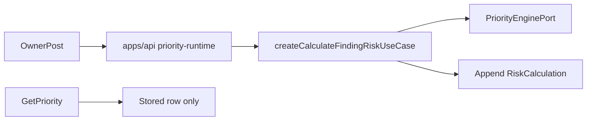

# ADR 0047: Controlled priority activation

- Status: Accepted
- Date: 2026-11-04
- Deciders: PatchPilot maintainers. Acceptance confirms the publication choice in section 4.
- Supersedes: none
- Superseded by: none

Accepted on 2026-11-04. Acceptance confirms the deployment-local publication
command in section 4. This ADR chooses the composition root for deliberate
priority calculation and the current-priority read, and how builtin
`patchpilot.builtin.v0` version 2 is published in production. It amends
[ADR 0012](0012-explainable-policy-engine.md): the deliberate calculation is
composed in the API process, and worker injection is reserved for a future
automatic-recalculation ADR. The routes and the publication command are
implemented. The production allowlist stays empty while V-0001 is unsigned, so
publication exits 2 and the routes return 503 until a signed pair is mirrored
and an operator runs the command. This ADR adds no migration.

[ADR 0045](0045-deterministic-p1-p4-priority-policy.md) is Accepted and does not
authorize composition. Operator weight validation
([priority weight validation](../security/priority-weight-validation.md), risk
register R13) is a separate gate. V-0001 is unsigned. No
(engine version, definition hash) pair is validated. This ADR's production
allowlist therefore starts empty, and both publication and calculation fail
closed until a signed `validated` or `validated_with_residuals` entry is mirrored
into that allowlist.

The frozen migration count is 27. This ADR adds no migration.

## Context

The authoritative chain is already built through Finding creation. Owner Product
Match Evidence evaluation ([ADR 0044](0044-deliberate-product-match-evidence-evaluation.md))
and owner `POST /findings` ([ADR 0036](0036-controlled-finding-operator-api.md))
are composed. Priority is not.

Repository truth at this decision:

- `createCalculateFindingRiskUseCase` and `createReadCurrentFindingRiskUseCase`
  exist in `packages/domain`. `PriorityEnginePort` is the engine boundary. Domain
  does not import `@patchpilot/policy-engine`.
- The PostgreSQL adapter is `packages/database/src/risk-calculation-persistence.ts`.
  Replay uniqueness is `risk_calculation_replay_key`
  `(organization_id, finding_id, input_fingerprint)`. RiskCalculation is
  append-only. `inputFingerprint` is the SHA-256 of `canonicalJson` of
  `{ engineVersion, policyDefinitionSha256, facts }` (ADR 0045 section 9, risk
  register R37).
- The adapter locks `pg_advisory_xact_lock(hashtextextended(organizationId:findingId, 0))`,
  locks the Finding `FOR UPDATE`, and admits only a Finding that is `open`,
  version 1, with null `current_risk_calculation_id` and null `due_at`.
- `priority:calculate_controlled` is owner only. `priority:inspect` is owner and
  admin. `PRIORITY_CONTROLLED_PRODUCTION_REGISTRATION` is `api_process`.
- The calculation reason is classified by the use case as `initial`, `rescan`,
  `intel_refresh`, `policy_change`, or `asset_change`. The writer rejects
  `manual_override` and `manual_recalc`.
- Current calculation is the latest row by `calculated_at DESC, id DESC`. The
  read use case does not call the engine. `current_risk_calculation_id` and
  `due_at` stay null under `patchpilot_finding_reject_update`.
- Builtin `patchpilot.builtin.v0` version 2, id
  `55555555-5555-4555-8555-555555555502`, is published only by the development
  seed. Production seeding is refused. Bootstrap publishes nothing. No migration
  inserts the row. `POLICY_ENGINE_VERSION` is `@patchpilot/policy-engine@1`.
- The read path returns `not_found` both when the Finding is absent and when it
  has no calculation. No accepted contract defines a calculation-freshness
  signal. Glossary "stale" means KEV catalog freshness, not calculation age.
- [ADR 0012](0012-explainable-policy-engine.md) said the worker injects the
  engine. [ADR 0026](0026-authoritative-match-evidence-and-finding-lifecycle.md)
  withholds `finding.recalculate`. The worker router rejects unknown job names.
- [ADR 0041](0041-controlled-finding-latest-observation-transport.md) is the
  precedent for an independent read-only section on `/findings/:findingId`.
- [ADR 0019](0019-local-password-sessions.md) governs cookie sessions,
  synchronizer CSRF, exact Origin, JSON mutations, and `Cache-Control: no-store`.

ADR 0045 section 9 and its follow-up left the composition root undecided. This
ADR is that decision.

## Decision

PatchPilot adopts one deliberate owner calculation command and one independent
current-priority read, both composed only in the API process. Reads return
stored rows. They do not evaluate the engine.



If the diagram is not rendered: an owner posts to the API. The API constructs
the existing use case, injects the pure engine through the port, and appends one
RiskCalculation. The read route returns the stored row and does not call the
engine.

### 1. Composition root

The only production constructor of the calculation use case and the
current-priority read is `apps/api/src/priority-runtime.ts`, analogous to
`composeControlledFindingOperatorRuntime`. It injects `PriorityEnginePort`.
Domain still does not import `@patchpilot/policy-engine`.

`apps/api` gains a workspace dependency on `@patchpilot/policy-engine`. That
package is internal. It is not a third-party dependency.

`PRIORITY_CONTROLLED_PRODUCTION_REGISTRATION` is `api_process`.

The worker, the web process, migration startup, the development seed, and API
startup do not construct the use case. Startup does not publish a policy.
Source-boundary tests keep every other runtime root from constructing it.

### 2. Calculation route

`POST /findings/:findingId/risk-calculations`.

- Owner only, permission `priority:calculate_controlled`. Admin, member, and
  viewer are denied.
- The organization comes from the trusted actor. A body, query, or header
  organization id is not authority.
- Strict JSON body `{}`. Any other key is rejected.
- Session cookie, synchronizer CSRF, exact Origin, JSON content type, 1 KiB
  body limit, and `Cache-Control: no-store`, per ADR 0019.
- Rate limit 5 requests per 60 seconds per direct socket peer, before
  authentication, and 5 per 60 seconds per organization after permission and
  body validation. Limits are process-local. A limiter fault fails closed.
  Restart clears the window. Several API processes multiply the ceiling. That
  multiplication is accepted for this slice. No Redis rate-limit table and no
  migration.
- The client does not supply `calculationReason`. The use case classifies it.

Responses:

| Outcome | HTTP | Body |
| --- | --- | --- |
| New row | 201 | `schemaVersion: finding_risk_calculation_v1`, `status: calculated`, `findingId`, `riskCalculationId`, `calculationReason` |
| Exact fingerprint replay | 200 | Same shape with `status: already_applied` |
| Foreign or absent Finding | 404 | `not_found`. The two cases are indistinguishable |
| Ineligible Finding | 409 | `finding_not_eligible`. No fact values |
| No admitted published builtin, or an organization override is present | 503 | `priority_policy_unavailable` |

Replay writes no second row and no second `priority.calculated` audit. The
audit subject is the Finding. Correlation is the request correlation. The
existing audit payload stays closed.

An ineligible Finding is one the adapter already rejects: not `open`, not
version 1, or a non-null pointer or `due_at`. The public code does not say
which predicate failed.

### 3. Fail-closed policy gate

Inside the calculation transaction the use case loads published builtin
`patchpilot.builtin.v0` version 2. It refuses unless both of the following hold:

- the stored definition's `policyDefinitionSha256` and the injected
  `POLICY_ENGINE_VERSION` are on the admitted-pair allowlist;
- the locked context has no organization override. Override publication stays
  uncomposed, so an override row is `priority_policy_unavailable` and writes
  nothing.

The allowlist is a required dependency of the composed use case, a readonly
list of `{ engineVersion, policyDefinitionSha256 }` pairs. Production passes the
constant that mirrors
[priority-weight-validation.md](../security/priority-weight-validation.md).
Only entries with outcome `validated` or `validated_with_residuals` may be
copied. Each addition cites the entry id. An empty list fails closed. Tests of
the use case pass an explicit fixture list. The production constant stays empty
while V-0001 is unsigned, so the composed route returns 503 until that mirror
lands. The unsigned V-0001 hash is not admitted by this ADR.

The KEV read stays a local database read. The transaction performs no network,
queue, or object-storage I/O.

### 4. Builtin publication command

Production publication is a deployment-local operator command, the same host
shape as the [ADR 0043](0043-instance-advisory-authority-grants.md) grant
command. Acceptance of this ADR confirms that choice over a data migration and
over publication at API startup.

The command inserts builtin `patchpilot.builtin.v0` version 2 only:

- id `55555555-5555-4555-8555-555555555502`;
- scope `builtin`, null organization, null membership creator, status
  `published`, policy schema version 2;
- definition `BUILTIN_PRIORITY_POLICY_DEFINITION` from
  `@patchpilot/policy-engine`, canonical JSON, display name
  `PatchPilot built-in P1-P4 priority policy`;
- `publishedAt` is the transaction timestamp when this command inserts the row.

It computes `policyDefinitionSha256` the same way `fingerprintCalculation` does.
It refuses, and writes nothing, when that hash paired with
`POLICY_ENGINE_VERSION` is absent from the production allowlist. Refusal happens
before the replay check, so an existing development-seed row is not reported as
success while the pair is unvalidated.

When the pair is admitted, exact replay is a no-op: the stored row has the same
id, key, version, and definition hash. Replay writes no second audit row,
including when the correlation id differs. A stored row with a different
definition, or the same key and version under a different id, is an immutable
conflict. The command does not update or delete it.
`risk_policy_builtin_key_version_uidx` matches `(policy_key, version)` where
`organization_id` is null, and `risk_policy_published_immutable` is the backstop.

One audit row on insert, action `risk_policy.published`, actor type `system`,
null user, null organization, and null membership. The payload reuses
`RiskPolicyPublishedAuditPayload`: `schemaVersion`, `riskPolicyId`, `policyKey`,
`policyVersion`, `policySchemaVersion`. The definition body and the hash are not
audit payload fields.

Process entry:
`packages/database/src/builtin-priority-policy-publication-command-main.ts`.
It loads the database URL through `@patchpilot/config` and does not read
`process.env`. Wrapper: `scripts/run-publish-builtin-priority-policy.mjs`, root
script `publish-builtin-priority-policy`. The script is not referenced from
`dev`, `build`, `test`, or `postinstall`. API, web, worker, scheduler, queue,
seed, and migration startup do not invoke it.

`@patchpilot/database` gains a runtime dependency on `@patchpilot/policy-engine`
so the built command can read the definition. Domain still does not import the
engine. The process entry passes the production allowlist constant. No flag
accepts a definition, a hash, or an allowlist override.

```text
pnpm publish-builtin-priority-policy -- --correlation-id <correlation-id>
pnpm publish-builtin-priority-policy -- help
```

`<correlation-id>` is a canonical lowercase UUID. `help` writes usage to stderr,
writes no JSON, and exits 0. Any other flag is `invalid_command`.

| Exit | Meaning |
| --- | --- |
| 0 | Inserted, or exact replay |
| 1 | Not built, or invalid command |
| 2 | Pair absent from the allowlist. No write |
| 3 | Immutable conflict. No write |
| 4 | Persistence failure. No partial policy row |

This command is the only production builtin writer. The development seed remains
development-only and is not that writer. The command adds no migration. The
table already exists. Publication is the operator act that R13 gates. A signed
validation entry is required before the allowlist can admit the pair, and the
command still has to be invoked explicitly after that.

### 5. Current-priority read

`GET /findings/:findingId/priority`.

- Requires both `priority:inspect` and `finding:inspect`. Owner and admin may
  read. Member and viewer are denied. `finding:read` does not grant it.
- Query parameters are rejected. No CSRF. No body.
- Rate limit 30 requests per 60 seconds per direct socket peer. Process-local,
  fail closed.
- Reads write no audit row.
- The organization predicate comes from the trusted actor.

The tenant-scoped read port returns one of `finding_absent`, `not_calculated`,
or `calculated` in a single read. That changes the port only. It does not change
the schema. HTTP maps `finding_absent` and a foreign Finding to the same 404
`not_found`. `not_calculated` is distinguishable only after the Finding is in
the actor's organization. Those roles can already read
`GET /findings/:findingId`.

`schemaVersion` is `finding_priority_v1`.

- `not_calculated`: `{ schemaVersion, status, findingId }` only. No priority,
  band, due-date, escalation, or null placeholder for those fields.
- `calculated`: `calculation`, `comparability`, `inputsChanged`, and `review`.
  `calculation` returns stored fields only: `riskCalculationId`, `calculatedAt`,
  `calculationReason`, `engineVersion`, policy identity (`riskPolicyId`,
  `policyKey`, `policyVersion`, `policyDefinitionSha256`), `priority`,
  `priorityBand`, escalation, due-date recommendation days, and the stored
  factor and rule rows with their closed explanation codes and contributions.
  The route does not recompute them.
- `comparability` is `reference` when the stored hash and engine version equal
  the published admitted builtin pair, and `incomparable` otherwise.
- `review` is the object defined by
  [ADR 0049](0049-append-only-priority-review.md). Until that ADR is composed,
  the only value is `{ status: 'none', priorReviewExists: false }`.

When the Finding is in the organization and no admitted published builtin
exists, the route returns 503 `priority_policy_unavailable` and does not return
`not_calculated` or `calculated`. Foreign and absent Findings still return 404
before that policy check.

`unavailable` here means the publication gate failed. It does not mean the
ADR 0045 all-unavailable evidence result. That result is a completed P4
calculation and is returned as `calculated`.

### 6. Input-change signals

`inputsChanged` compares stored identifiers only. It does not assemble facts and
does not call the engine. `status` is `none_detected` or `detected`. `signals`
lists only the codes that fired, in this order:

1. `policy_superseded`: stored `policyDefinitionSha256` differs from the
   published reference hash.
2. `engine_version_changed`: stored `calculationEngineVersion` differs from the
   injected `POLICY_ENGINE_VERSION`.
3. `kev_generation_changed`: stored `factors.sources.kev.generationId`, or null
   when that field is absent, differs from the active KEV generation id, or
   null when there is no active generation.
4. `observed_after_calculation`: `Finding.lastObservedAt` is later than
   `calculatedAt`. Equal timestamps do not fire.
5. `asset_updated_after_calculation`: `Asset.updatedAt` is later than
   `calculatedAt`.

`detected` means a deliberate recalculation may produce a new row. A
recalculation can still replay. The contract does not say the stored priority
is current or accurate. Age-bucket crossing is not a signal. The response shows
`calculatedAt` instead. That gap is residual R-A1.

### 7. Finding page section

An independent section on `/findings/:findingId` follows ADR 0041 and
[ADR 0038](0038-controlled-finding-web-workflow.md):

- Owners and admins see the read. Members and viewers do not.
- The owner sees a Calculate priority control that posts `{}` to section 2.
  Admins do not.
- The control reads the CSRF token from auth-provider memory at submit time.
- `not_calculated` renders the text "Not calculated" with no band styling.
- An error in this section does not erase creation inspection or the
  latest-observation section.
- The section keeps no durable copy of the response. Organization switch and
  unmount discard it.
- Untrusted text is escaped React text. The page sends
  `Content-Security-Policy: frame-ancestors 'none'`.
- No Next.js route handler and no web-server calculation.

### 8. Still unauthorized

This ADR does not authorize RemediationTask, assignment, `dueAt` writes,
RiskAcceptance, compensating controls, Finding state transitions,
`finding.recalculate`, worker scoring, automatic recalculation on Finding
creation, KEV sync, SBOM ingestion, asset change, or policy publication,
organization override publication, `manual_override` or `manual_recalc`
calculations, a Finding list, global search, or any AI role in priority.

Recalculation after inputs change is the same owner command. The queue is
[ADR 0048](0048-controlled-remediation-queue.md). Reviews are ADR 0049.

## Alternatives considered

- **Worker Outbox job first.** Automatic, and a system KEV job would fan out
  tenant work. Deferred to a later ADR that reuses this use case and fingerprint.
- **Calculating inside `POST /findings`.** Changes the accepted creation
  transaction and audit (ADR 0035 and ADR 0036) and couples creation to R13.
- **Calculating on read.** Breaks the stored-row invariant.
- **A Next.js route handler or web-side composition.** The web app is an API
  client.
- **Publishing the builtin in a data migration.** That needs migration 28 and
  publishes on deploy. Rejected. The operator command is the accepted choice
  of this proposal.
- **Publishing at API startup.** An automatic write at boot.

## Consequences

- Positive: one constructor, one publication writer, replay, and a visible
  not-calculated state.
- Negative: priority stays 503 until R13 is signed and an operator runs the
  command. Process-local rate limits multiply across API processes.
- `@patchpilot/database` takes a runtime dependency on
  `@patchpilot/policy-engine` for the command. `apps/api` takes the same
  dependency to inject the port.
- No migration. The frozen count stays 27 through this ADR's implementation.
- The implementation pull request updates the checkpoint. This proposal does
  not compose the route.

## Security and tenancy

The organization comes from the actor. Composite tenant keys bind the
calculation, the Finding, and the organization. Foreign and absent Findings
share `not_found`. The builtin row and the KEV generation are instance data.
`risk_calculation_policy_org_consistency` already rejects a cross-tenant policy.
The reason text of a review is not part of this ADR. Calculation responses
carry closed codes and stored numbers. Logs omit the definition body, fact
payloads, and the canonical redaction list in
[security rules](../../.cursor/rules/security.mdc). No output claims
exploitability, compliance, or remediation. A validated policy, once R13 is
signed, is a validated operator policy proposal with its validation date.

## Operational failure plan

- **Allowlist empty or pair missing.** Publication exits 2. The route returns
  503. The operator signs a validation entry, mirrors the pair, then runs the
  command. Historical calculations are not rewritten.
- **Builtin row missing after admission.** 503. The operator runs the command.
  Exact replay is safe.
- **Immutable conflict on publication.** Exit 3. The operator does not edit the
  row. A new policy version is a later ADR.
- **Ineligible Finding.** 409, no write. The operator does not change Finding
  state through this route.
- **Engine or database error mid-transaction.** The transaction rolls back. No
  partial calculation and no audit row.
- **Override row present.** 503, no write. Override publication is a later ADR.
- **Bad stored priority.** Roll forward with a new policy version and a
  deliberate recalculation. History stays.

## Follow-up

- Implement the composition module, both routes, the publication command, the
  allowlist constant, the read-port states, the Finding page section, and the
  runbook.
- Tests: foreign Finding `not_found`; replay writes no second row or audit;
  unvalidated hash fails closed; missing builtin returns 503; CSRF and Origin
  rejection; member, viewer, and admin denial on the post; member and viewer
  denial on the read; zero `finding.recalculate` Outbox rows; no band field on
  `not_calculated`; a spy shows the engine is not called on read; each
  `inputsChanged` signal fires only on its stored-identifier comparison.
- On acceptance, keep the ADR 0012 amendment. The implementation pull request
  updates [current state](../project/current-state.md) and the
  [ADR index](README.md).
- [ADR 0048](0048-controlled-remediation-queue.md) and
  [ADR 0049](0049-append-only-priority-review.md) consume this read. They are
  separate acceptances.
