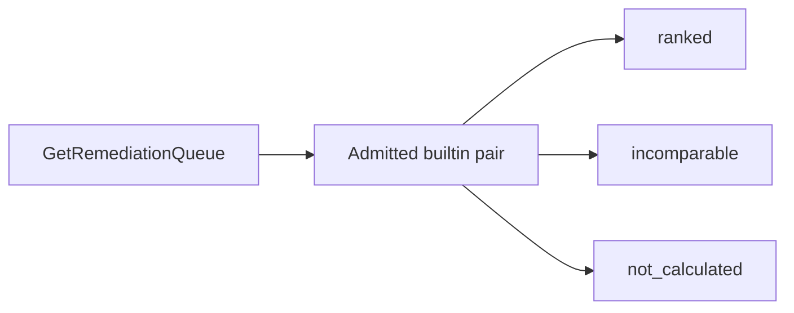

# ADR 0048: Controlled remediation queue

- Status: Accepted
- Date: 2026-11-04
- Deciders: PatchPilot maintainers. Acceptance confirms that a review never changes queue order.
- Supersedes: none
- Superseded by: none

On 2026-11-05, [ADR 0051](0051-remediation-queue-export.md) partially supersedes
only the no-export sentences in the Decision opening and in section 7. Status
stays Accepted. Superseded by stays none. All other queue semantics remain in
force, including permission, pagination, section partition, comparator,
unaudited reads, and that a review does not change order.

Accepted on 2026-11-04. Acceptance confirms that a review never changes queue
order. This ADR admits one read-only Finding list, `GET /remediation-queue`,
and the page `/remediation-queue`. It is the architecture review
[ADR 0038](0038-controlled-finding-web-workflow.md) section 24 requires before
any Finding list. The list is not a RemediationTask list. Acceptance lifts ADR
0038's no-list limit only for this route and this page. Target discovery still
returns no Finding id.

The route and the page are implemented. The production allowlist admits V-0001.
The route returns 503 until an operator publishes that builtin in the
deployment. Admission does not publish a row. The review marker comes from
[ADR 0049](0049-append-only-priority-review.md) and does not change order. It depends on the reference policy
from [ADR 0047](0047-controlled-priority-activation.md). It adds no migration.
The frozen migration count stays 28.

## Context

[ADR 0037](0037-controlled-finding-target-discovery.md) does not authorize
`GET /findings` or cross-asset discovery.
[ADR 0040](0040-controlled-finding-latest-observation-inspection-boundary.md)
says a new read permission needs its own ADR.
[ADR 0045](0045-deterministic-p1-p4-priority-policy.md) section 5 defines
`compareForRemediationQueue`: `incomparable` across policy keys, with the caller
responsible for definition-hash equality, then priority descending, escalation
first, KEV listed first, source-severity percent descending, then the caller's
`Finding.firstObservedAt` and `Finding.id`.

No permission, route, or ordering contract exists for a Finding list. Priority
lives in `result` JSON. No priority index exists. A single ordering that placed
Findings without a calculation last would treat a missing calculation as a rank
below P4. ADR 0045 calculates all-unavailable evidence as a completed P4 and
does not treat a missing calculation as that result.

[Remediation lifecycle](../architecture/remediation-lifecycle.md) describes task
and risk-acceptance queues. Those queues are not this route.
[ADR 0049](0049-append-only-priority-review.md) is a marker on a row, not a
change to order.

Keyset cursors already exist on `GET /assets`, the SBOM list, and controlled
Finding target discovery. Discovery returns `stale_cursor` (409) when its
binding changes.

## Decision

PatchPilot adopts one read-only remediation queue. It is the only Finding list.
There is no generic `GET /findings`, no search, no filter, and no export.
[ADR 0051](0051-remediation-queue-export.md) partially supersedes only the
export prohibition in this sentence.

If the diagram is not rendered: the request resolves the admitted builtin pair,
then returns one of three independently paginated sections. Every Finding in
the organization is in exactly one section. There is no concatenated ordering.

### 1. Permission and route

`GET /remediation-queue`.

- New permission `remediation_queue:read`, owner and admin only. The route also
  requires `priority:inspect`. `finding:read` does not grant the queue.
  `finding:inspect` does not grant it by itself.
- Member and viewer are denied.
- The organization comes from the trusted actor. A query organization id is
  rejected.
- Accepted query parameters are `section`, `cursor`, and `limit` only. Anything
  else, including a filter, is rejected.
- `section` is required: `ranked`, `incomparable`, or `not_calculated`.
- `limit` defaults to 20 and is at most 50.
- No CSRF. Reads write no audit row.
- Rate limit 30 requests per 60 seconds per direct socket peer and 20 per 60
  seconds per organization. Process-local, fail closed. Several API processes
  multiply the ceiling. That multiplication is accepted. No migration.

`schemaVersion` is `remediation_queue_v1`. Every response carries `asOf` (the
database read time, UTC), the three section counts, and the page for the
requested section. The three counts add up to the organization's Finding count.

When no admitted published builtin exists, the route returns 503
`priority_policy_unavailable`. V-0001 is admitted. The route still returns 503
until an operator publishes that builtin in the deployment. A 503 body has no
Finding rows.

### 2. Reference policy and section membership

The reference policy is the currently published, allowlisted builtin
(`patchpilot.builtin.v0`, version 2, definition hash) plus the injected
`POLICY_ENGINE_VERSION`, resolved at request time.

The latest calculation is the ADR 0045 read: `calculated_at DESC, id DESC`,
limited to one row, scoped by organization. Section membership:

- `ranked`: that row's `policyDefinitionSha256` and `calculationEngineVersion`
  equal the reference.
- `incomparable`: a latest row exists and the hash or the engine version
  differs.
- `not_calculated`: the Finding has no calculation.

A Finding with no calculation never appears in `ranked` or `incomparable`.

### 3. Ordering

`ranked` uses the ADR 0045 keys, implemented in SQL over stored fields only:

1. `result.priority` descending.
2. `result.escalationRecommendation` true first.
3. KEV listed first, from the stored `kev_listed` factor: `inputState` observed
   and `observedValue` in the engine's listed tokens.
4. Stored `source_severity` `normalizedPercent` descending.
5. `Finding.firstObservedAt` ascending.
6. `Finding.id` ascending, lowercase canonical UUID, bytewise.

The request path does not call `compareForRemediationQueue`. A contract test
runs that comparator and this ordering over the same fixtures and requires the
same order. Caller keys 5 and 6 stay outside the engine, as ADR 0045 requires.

`incomparable` orders by `calculatedAt` ascending, then `id` ascending. The row
carries its own policy identity and the fixed message "recalculation required
for comparison". No cross-policy rank is shown. The stored band and priority
may be shown as values of that other policy. They are not placed on the ranked
scale.

`not_calculated` orders by `firstObservedAt` ascending, then `id` ascending. No
band, priority, or due field is present.

Pages are deterministic for one database state. They are not a snapshot. A
recalculation between pages may move a row. The web copy says so.

### 4. Cursor

The cursor is opaque and bound to the section, the reference definition hash,
the engine version, and the last key tuple. The client does not build it. A
cursor whose section, hash, or engine version differs from the request returns
409 `stale_cursor`. A changed reference, including publication of a newly
admitted hash, invalidates outstanding cursors.

### 5. Row fields

Every row: `findingId`, `assetId`, asset display name, component name, component
version, and the vulnerability public identifier. Those strings match what
inspection already shows, plus the occurrence version. Component name, version,
and asset name are untrusted text.

Calculated rows also include band, priority, policy identity, `calculatedAt`,
the ADR 0047 `inputsChanged` signals, and `humanReview`.

`not_calculated` rows omit band, priority, policy, and due fields.

`humanReview` is the marker defined by ADR 0049. A calculated row reports the
current review head. A row with no calculation reports `none`. The marker
never reorders the row.

No assignment, due date, Finding state, or RemediationTask field appears.

### 6. Web page

`/remediation-queue` is an API client under ADR 0038.

- Navigation shows the link to owners and admins only. The API remains the
  authority for denial.
- Three visibly separate panels. "Not calculated" is not rendered under P4 as a
  lower band. `incomparable` is not merged into `ranked`.
- Rows link to `/findings/:findingId`.
- No Next.js route handler. Untrusted text is escaped.
  `Content-Security-Policy: frame-ancestors 'none'`.
- State is discarded on organization switch or unmount.

### 7. Still unauthorized

No generic Finding list, search, filter, export, create-all, or cross-asset
discovery beyond this queue. [ADR 0051](0051-remediation-queue-export.md)
partially supersedes only the export prohibition in this sentence. Target
discovery still returns no Finding id. No priority index. No worker. No
recalculation on read. No RemediationTask and no RiskAcceptance. A review does
not change rank. That split is the acceptance choice of this proposal; a later
ADR would be required before a review could affect order, and that later ADR
would have to do it through a versioned policy.

## Alternatives considered

- **One merged ordering with missing calculations last.** Treats a missing
  calculation as a rank below P4.
- **Ranking across policy versions by the raw priority number.** ADR 0045
  returns `incomparable` across policies.
- **Recalculating on read to force one hash.** Breaks the stored-row invariant.
- **Reusing `finding:inspect` alone.** ADR 0040 requires a separate permission
  decision. This ADR is that decision.
- **Granting members access through `finding:read`.** `finding:read` is not
  inspection authority and is not queue authority.
- **A RemediationTask list.** Tasks are not composed, and this queue is a
  Finding read.
- **A priority index now.** Needs a migration. Deferred until measured.

## Consequences

- Positive: owners and admins can see every Finding in the organization once,
  split by whether it can be compared.
- Negative: the route discloses the organization's Finding ids to roles that
  can already inspect a Finding by id. It discloses nothing to members or
  viewers.
- No migration. Ordering over JSON is accepted until measurement says an index
  is required.
- The page is not a remediation workflow. Task and acceptance states stay
  unrouted.

## Security and tenancy

Every query includes the actor's `organizationId`. A foreign organization's
Findings are absent from all three sections and from the counts. Untrusted
component and asset text is escaped. The builtin hash and the engine version
are instance data. The ADR 0038 rule that target discovery must not reveal
Finding ids stays in force for that page. Logs carry the route template and a
closed outcome. They omit row text, cursors that embed identifiers, and the
canonical redaction list.

## Operational failure plan

- **No admitted builtin.** 503. No rows. The operator follows the ADR 0047
  publication failure plan.
- **Stale cursor.** 409. The client discards the cursor and reloads the first
  page. The server does not resume on the new reference.
- **Ordering drift.** The contract test fails. The SQL is corrected to the
  comparator. Stored rows are not rewritten.
- **Count mismatch.** A defect. The three counts are defined as a partition of
  the organization's Findings. The route fails closed rather than returning a
  page whose counts disagree with that partition.

## Follow-up

- The permission, domain read, PostgreSQL read, contracts, route, and page are
  implemented. Tests cover tenant isolation, the section partition, comparator
  equivalence, stable pages, a stale cursor, and member and viewer denial.
- ADR 0038 records that the no-list lift is only `GET /remediation-queue` and
  `/remediation-queue`.
- [current state](../project/current-state.md) records the composed route. No
  migration, so the frozen count stays 28.
