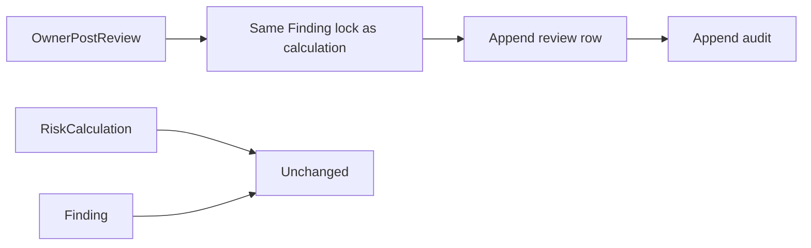

# ADR 0049: Append-only priority review

- Status: Proposed
- Date: 2026-11-04
- Deciders: PatchPilot maintainers. Acceptance confirms no two-person rule and no effect on queue rank.
- Supersedes: none
- Superseded by: none

Proposed. Acceptance is a maintainer decision. This ADR admits an append-only
human review of one immutable RiskCalculation. Acceptance and correction here
are reviews. They are not RiskAcceptance and they are not priority overrides.

The implementation session of this ADR is the session that adds migration 28.
This proposal adds no migration and authorizes no writer while it remains
Proposed. The frozen migration count stays 27 until that implementation merges.

## Context

[ADR 0045](0045-deterministic-p1-p4-priority-policy.md) excludes manual override,
risk acceptance, and AI from engine inputs, and says nothing else overrides the
score. The calculation writer rejects `manual_override` and `manual_recalc`.
`patchpilot_finding_reject_update` forbids changes to Finding `state`,
`version`, `current_risk_calculation_id`, `due_at`, and assignment.
`patchpilot_forbid_mutation` is the append-only trigger already used by evidence
tables. Tenant audit uniqueness is
`(organization_id, action, subject_id, correlation_id)`.

[Risk policy](../architecture/risk-policy.md) and
[remediation lifecycle](../architecture/remediation-lifecycle.md) sketched a
manual override as a new RiskCalculation plus an expiry job. The writer refuses
that reason. The `risk_acceptance` table is mutable: it has `updated_at` and no
append-only trigger. Using it would also imply a `risk_accepted` occupancy
change, and no lifecycle ADR exists. Remediation lifecycle text lets a member
request acceptance. [ADR 0019](0019-local-password-sessions.md) grants
`risk_acceptance:request` to admin and owner only, and that permission stays
unrouted.

No `priority:review_controlled` permission and no review table exist.
[ADR 0042](0042-maintainer-reviewed-advisory-production-composition.md) compares
canonical `User.id` values for advisory separation of duties. A priority review
grants no eligibility and changes no authoritative row, so this slice does not
copy that two-person rule. ADR 0019 already records that an owner may both
request and approve risk acceptance. The same shape of residual applies here.

Product Match Evidence and RiskCalculation rows are immutable. The calculation's
`factors` already reference the creation evidence.

## Decision

A review records what a human says about one immutable calculation. It does not
change the calculated priority, the queue rank, the due-date recommendation,
the Finding row, or occupancy. A wrong score is fixed by a new policy version
under ADR 0045. Corrections are evidence for that later change. Acceptance of
this ADR confirms both of those choices.

If the diagram is not rendered: the owner posts a review. The transaction takes
the calculation writer's Finding lock, appends one review and one audit row, and
leaves the RiskCalculation and the Finding unchanged.

### 1. Vocabulary

- `accepted`: a human confirms that this calculation stands as the working
  priority.
- `corrected`: a human records a different working band, with a reason and an
  expiry. The calculated band stays the stored band.
- `withdrawn`: a human retracts the current review.
- The current review is the head of the chain for the current calculation. The
  head is the row that no other row supersedes.
- An expired correction is reported as `expired` by comparing `expires_at` with
  the database clock at read time. There is no expiry job and no write.
- A newer RiskCalculation makes earlier reviews historical. The read reports
  `none_for_current_calculation` with `priorReviewExists: true`.

### 2. Migration 28

One new table, `risk_calculation_review`, in the next forward-only migration.
That migration becomes frozen migration 28. `FROZEN_MIGRATIONS` becomes 28 in
the same pull request. No earlier migration is edited.

Columns:

| Column | Rule |
| --- | --- |
| `id` | UUID |
| `organization_id` | Tenant predicate |
| `finding_id` | Composite foreign key to `finding_org_id_key` |
| `risk_calculation_id` | Composite foreign key to `risk_calculation_org_id_key` |
| `supersedes_review_id` | Nullable. Composite foreign key to this table's `(organization_id, id)` |
| `decision` | Text, check `accepted`, `corrected`, or `withdrawn` |
| `corrected_band` | Nullable text, check `P1`, `P2`, `P3`, or `P4` |
| `expires_at` | Nullable `timestamptz` |
| `reason` | Nullable `varchar(2000)`. Untrusted text |
| `reason_sha256` | Nullable `char(64)`. Required when `reason` is non-null |
| `actor_user_id` | Canonical user id |
| `actor_membership_id` | Membership in the same organization |
| `correlation_id` | Request correlation |
| `created_at` | Database UTC. There is no `updated_at` |

Checks on the review row:

- `corrected` requires a non-null band, a non-empty reason, and `expires_at`
  later than `created_at` and at most 180 days later.
- `accepted` forbids a band and `expires_at`. Reason is optional.
- `withdrawn` requires `supersedes_review_id` and a non-empty reason, and
  forbids a band and `expires_at`.
- `reason_sha256` is present exactly when `reason` is present.

Indexes and triggers:

- Partial unique index on `(organization_id, risk_calculation_id)` where
  `supersedes_review_id` is null, so there is one root review per calculation.
- Unique index on `(organization_id, supersedes_review_id)` where
  `supersedes_review_id` is not null, so the chain cannot fork.
- `ON DELETE RESTRICT` on every foreign key.
- `BEFORE UPDATE OR DELETE` executes `patchpilot_forbid_mutation()`.
- Trigger `patchpilot_risk_calculation_review_chain`: the calculation belongs to
  the same Finding, a superseded review references the same calculation and the
  same organization, and a `corrected` band differs from the stored
  `result.priorityBand`.

The band comparison reads another row, so it is not a single-row check. The
application checks it before insert. The trigger is the backstop.

### 3. Route

`POST /findings/:findingId/priority-reviews`.

- Owner only, new permission `priority:review_controlled`. Admin, member, and
  viewer are denied.
- Body, strict:
  `{ riskCalculationId, supersedesReviewId, decision, correctedBand?, expiresAt?, reason? }`.
  `supersedesReviewId` is a UUID or null.
- ADR 0019 guards: session cookie, synchronizer CSRF, exact Origin, JSON
  content type, `Cache-Control: no-store`. Body limit 4 KiB.
- Rate limit 5 requests per 60 seconds per direct socket peer and 5 per 60
  seconds per organization. Process-local, fail closed.
- The organization comes from the trusted actor.

The reason is NFC-normalized and length-bounded before hashing and storage. It
is never logged. `reason_sha256` is the SHA-256 of the stored NFC text.

| Outcome | HTTP | Body `status` |
| --- | --- | --- |
| New review | 201 | `recorded` |
| Content matches the current head | 200 | `already_applied` |
| Foreign or absent Finding, calculation, or review | 404 | `not_found`, one body for all three |
| Named calculation is not the latest | 409 | `calculation_not_current` |
| Named supersession is not the current head | 409 | `review_not_current` |

`schemaVersion` is `priority_review_v1`. Success bodies carry `reviewId`,
`findingId`, and `riskCalculationId`. They omit the reason text.

The server never substitutes a newer calculation or a newer head. Stale
acknowledgements fail closed, as in ADR 0037. The unique indexes are the
backstop when two transactions race.

### 4. Transaction

The transaction takes the same advisory lock as the calculation writer:
`pg_advisory_xact_lock(hashtextextended(organizationId:findingId, 0))`. Reviews
and calculations on one Finding serialize. It then:

1. Reloads the actor's membership from PostgreSQL.
2. Locks the Finding `FOR UPDATE`.
3. Requires `riskCalculationId` to be the latest calculation
   (`calculated_at DESC, id DESC`). Otherwise 409 `calculation_not_current`.
4. Requires `supersedesReviewId` to equal the current head. A first review
   requires null. Otherwise 409 `review_not_current`.
5. If the decision, band, expiry, and reason hash equal the head, returns
   `already_applied` and writes nothing.
6. Inserts the review and the audit row, then commits.

No network, queue, or object-storage I/O inside the transaction.

Separation of duties: no two-person rule. The owner who calculated may review.
That self-review residual is recorded beside ADR 0019's request-and-approve
residual. A review grants no permission and changes no authoritative state.
Advisory approval stays the two-person path. This route does not.

### 5. Audit

One audit row in the same transaction as the review. Actions:
`priority.review_accepted`, `priority.review_corrected`,
`priority.review_withdrawn`. Subject type `risk_calculation_review`. Subject id
is the review id. Actor type `user`, with the actor's user id, organization,
and membership.

Payload keys only: `schemaVersion`, `reviewId`, `findingId`,
`riskCalculationId`, `decision`, `correctedBand`, `expiresAt`,
`supersedesReviewId`, `reasonLength`. No reason text. `priority.override` stays
catalog-only and is not emitted.

Replay writes no second audit row. No review row is updated or deleted. Nothing
cascades.

### 6. Read and queue marker

[ADR 0047](0047-controlled-priority-activation.md) `review` and
[ADR 0048](0048-controlled-remediation-queue.md) `humanReview` use this
projection. Status is one of `none`, `accepted`, `corrected`, `expired`,
`withdrawn`, or `none_for_current_calculation`. `priorReviewExists` is true when
any review exists for an earlier calculation of the same Finding.

The Finding priority read may include the current head's reason text for owners
and admins, rendered as escaped text. The queue marker does not include the
reason. Neither projection changes order, band, or due-date recommendation.
`expired` is computed at read time and is not stored.

The Finding page gains a review section independent of creation inspection and
of the latest-observation section. An error in the review section does not
erase those sections. The owner posts from that section. Admins can read and
cannot post. The CSRF token is read from auth-provider memory at submit time.
The section is discarded on organization switch or unmount.

### 7. Still unauthorized

Product Match Evidence review is deferred. A false-positive correction is a
Finding occupancy change and belongs to a future lifecycle ADR. Evidence
identity stays the calculation's stored factor references.

This ADR does not authorize RiskAcceptance, a `manual_override` calculation, an
expiry job, a change to queue order, assignment, `dueAt` writes, Finding state
transitions, or AI text as a review.

## Alternatives considered

- **Inserting a `manual_override` RiskCalculation.** Puts a human judgment into
  engine history, breaks fingerprint replay, and contradicts ADR 0045.
- **Reusing `risk_acceptance`.** The table is mutable, and acceptance implies a
  `risk_accepted` state change.
- **Recording the review only in audit.** Free text would land in the audit log,
  there would be no subject row, and correlation uniqueness would collapse
  repeated reviews.
- **Updating an earlier review to superseded.** An in-place rewrite.
- **Letting a correction reorder the queue.** Makes a human override
  authoritative without a versioned policy. Rejected for this slice.
- **Admin or member reviewers.** The permission is owner only.
- **A two-person rule.** Rejected for this slice because the review changes no
  authoritative state. The self-review residual is recorded.

## Consequences

- Positive: human disagreement is durable, ordered, and separate from the score.
- Negative: the queue can show a corrected band beside a calculated rank that
  disagrees. Operators read both. The rank stays the calculated rank.
- One migration. The frozen count becomes 28 only when the implementation
  merges.
- `risk_acceptance:*` stays unrouted. The member-request sentence in the
  remediation lifecycle doc is not this permission.

## Security and tenancy

The organization comes from the actor. Composite foreign keys make a
cross-tenant subject impossible. Foreign and absent subjects share `not_found`.
The reason is untrusted: NFC-normalized, at most 2000 characters, escaped on
render, and absent from logs and from the audit payload. Reason length in the
audit payload is an integer. Reviewers see the reason only on the Finding
priority read, which already requires inspection.

## Operational failure plan

- **Stale calculation or stale head.** 409. The client reloads the priority
  read and submits again. The server does not rewrite the acknowledgement.
- **Chain fork.** The unique index aborts the transaction. No partial row.
- **UPDATE or DELETE.** `patchpilot_forbid_mutation` rejects it.
- **Audit unique collision.** The transaction aborts. Retry with a new
  correlation id. Exact content replay still writes nothing.
- **Wrong review committed.** Append a `withdrawn` row, or append a later
  review that supersedes the head. The wrong row stays.
- **Expired correction.** The read reports `expired`. No job writes. The
  calculated rank is unchanged. A new review may supersede it while the
  calculation is still current.

## Follow-up

- Implement migration 28, the use case, the port, the adapter, the permission,
  contracts, the route, the Finding section, and the queue marker.
- Tests: tenant isolation; replay; stale acknowledgement 409; a chain fork
  rejected by the unique index; UPDATE and DELETE rejected by the trigger; the
  Finding row unchanged; the RiskCalculation row unchanged; queue order
  unchanged; no reason text in the audit payload or the logs.
- Update the [audit model](../architecture/audit-model.md) when the actions are
  implemented.
- The implementation pull request sets the frozen migration count to 28 in
  [current state](../project/current-state.md) and
  `packages/database/src/integration-database.ts`.
