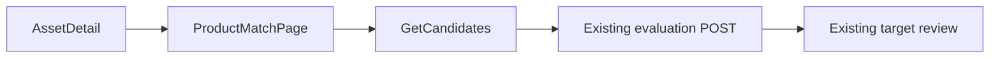

# ADR 0050: Product Match Evidence evaluation web workflow

- Status: Accepted
- Date: 2026-11-04
- Deciders: PatchPilot maintainers. Acceptance confirms owner-only discovery and a withheld CVE identifier.
- Supersedes: none
- Superseded by: none

Accepted on 2026-11-04. This ADR admits one asset-scoped read of evaluation
candidates and one owner web page that posts the existing evaluation command.
It does not change that command. `GET /assets/:assetId/product-match-candidates`
and `/assets/:assetId/product-match-evaluations` are implemented. It adds no
migration. The frozen migration count stays 28.

On acceptance, [ADR 0044](0044-deliberate-product-match-evidence-evaluation.md)
residual R-3 narrows: revision identifiers for this workflow come from the
asset-scoped read, and the page is the web UI ADR 0044 withheld. ADR 0044's
POST contract stays in force. A global advisory catalog remains withheld.

This ADR does not depend on [ADR 0045](0045-deterministic-p1-p4-priority-policy.md)
or on [ADR 0047](0047-controlled-priority-activation.md).

## Context

ADR 0044 accepts owner `POST /assets/:assetId/product-match-evaluations` with
body `{ advisoryRevisionId }` only, permission `product_match:evaluate_controlled`,
and the eligibility envelope in its section 4. Advisory rows are not returned.
The decision says there is no web UI. Advisory listing for owners is an open
follow-up. Residual R-3 says revision identifiers travel out of band.

No read route exists from which a page could discover candidates. ADR 0038
cannot supply one: that workflow adds no backend route.
[ADR 0042](0042-maintainer-reviewed-advisory-production-composition.md) and
[ADR 0043](0043-instance-advisory-authority-grants.md) add no advisory read.

"Approved" is not a column. Approval is the existence of one
`MaintainerReviewedAdvisoryApproval` row. `trust_classification` stays
`unreviewed`. Offline-import revisions are not evaluation-eligible.
`assessDeliberateProductMatchAdvisory` is the deliberate eligibility predicate.
Package identity uses `classifyNpmPackageIdentityFromParts`. Ingestion and
occurrence admission use `classifyDeliberateIngestionPointer` and
`classifyDeliberateOccurrenceVersion`.

The real product-eligible evaluation count remains 0. The page must say so
when the candidate list is empty.

## Decision

PatchPilot adopts one owner-only candidate read and one nested web page. The
evaluation POST is unchanged. Discovery reuses the evaluator's predicates. It
does not become a second correlation engine.

If the diagram is not rendered: the owner opens the asset page, loads
candidates, confirms one revision, and the browser posts
`{ advisoryRevisionId }` to the existing route. After a committed evaluation the
page links to target review. It never creates a Finding.

Acceptance confirms two choices. Discovery is owner only. Admins are not given
a read-only mirror; ADR 0044 requires a later permission review before the
evaluate permission is widened, and this read is the same authority boundary.
The CVE identifier is withheld in this slice.

### 1. Permission

New permission `product_match:discover_controlled`, owner only. Admin, member,
and viewer are denied. `product_match:evaluate_controlled` does not grant the
read, and the read does not grant evaluation. `intelligence:read`,
`finding:read`, and `asset:manage` do not grant it. Instance advisory grants do
not grant it.

The permission is added to the catalog only by the implementation branch.

### 2. Candidate route

`GET /assets/:assetId/product-match-candidates`.

- The organization comes from the trusted actor. The path asset id is a
  resource selector, not tenancy.
- Foreign and absent assets return the same 404 `not_found`.
- Scope is the asset's `last_successful_sbom_ingestion_id` when that ingestion
  is `completed` and normalization version 2, ecosystem npm. Any other pointer
  yields an empty page for an asset the actor can see, not a list of ineligible
  revisions. A missing asset is still `not_found`.
- A candidate revision's package identity equals a component in that ingestion
  and the revision satisfies the ADR 0044 eligibility envelope: local
  maintainer-reviewed origin, one approval for the product-evaluation purpose,
  disposition `recorded`, not withdrawn, not quarantined, no successor.
  Superseding tips stay ineligible, as in ADR 0044's first-slice narrowing.
- The route calls `assessDeliberateProductMatchAdvisory` and the existing npm
  identity and deliberate ingestion classifiers. It does not reimplement those
  predicates.
- Read only. No audit row.
- Query parameters are `cursor` and `limit` only. `limit` defaults to 10 and is
  at most 20.
- Rate limit 30 requests per 60 seconds per direct socket peer and 20 per 60
  seconds per organization. Process-local, fail closed.
- `schemaVersion` is `product_match_candidates_v1`.

Each candidate exposes only:

- `advisoryRevisionId`;
- `ecosystem`;
- `packageNamespace` and `packageName` (untrusted text);
- `matchedOccurrenceCount` for this ingestion;
- `evaluationState`: `not_evaluated` or `evaluated`.

`evaluated` means at least one tenant-owned Product Match Evidence row exists
for this organization, this asset, this ingestion, and this revision.
`not_evaluated` means no such row. The check is organization-scoped. Another
organization's evidence is invisible. The count is not a promise that the POST
will write evidence. The POST remains the capacity and eligibility authority.

Withheld:

- author, reviewer, and approval identities;
- provider identities and `osvId`;
- the CVE identifier;
- all digests and fingerprints;
- range events and explicit versions;
- capability and approval internals;
- ineligible, withdrawn, quarantined, superseded, synthetic, KEV, and
  offline-import revisions;
- other organizations' evidence or ingestion data;
- raw SBOM bytes and provenance hashes.

The instance catalog is read without an organization predicate. Tenant evidence
existence is organization-scoped. No ranges are returned, so the range oracle
stays the POST (ADR 0044 residual R-5).

### 3. Ordering and cursor

Order is `packageNamespace`, then `packageName`, then `advisoryRevisionId`,
with `COLLATE "C"`. A null namespace sorts before any non-null namespace, and
that order is stable.

The cursor is opaque and bound to the ingestion id and the last key tuple. A
newer `last_successful_sbom_ingestion_id` returns 409 `stale_cursor`. The client
discards the list.

### 4. Web page

`/assets/:assetId/product-match-evaluations`, mirroring ADR 0038.

- One owner-only link from asset detail. No prefetch of candidates on asset
  detail.
- Candidates are confirmed one at a time. The dialog posts
  `{ advisoryRevisionId }` only, to the existing evaluation route.
- The CSRF token is read from auth-provider memory at submit time.
- No auto-retry on commit uncertainty. No evaluate-all.
- State is discarded on organization switch or unmount.
- No Next.js route handler. Text is escaped.
  `Content-Security-Policy: frame-ancestors 'none'`.
- The page compares the POST response `ingestionId` with the ingestion it
  discovered against. When they differ, it shows a bounded notice and discards
  the candidate list.
- After `evaluated`, the page links to the existing
  `/assets/:assetId/findings/targets`. It never creates a Finding.
- The empty state says there is nothing to evaluate. It does not imply a
  product-eligible catalog exists. The real product-eligible count remains 0
  until eligibility composition changes, which this ADR does not do.

### 5. POST contract

`POST /assets/:assetId/product-match-evaluations` stays byte-for-byte the
ADR 0044 contract: body `{ advisoryRevisionId }` only, owner permission
`product_match:evaluate_controlled`, the same guards, and the same audit rule.
`vulnerability.match_evaluated` is written only when at least one new evidence
row commits. This page adds no field to that body. `ingestionId` stays off the
POST.

Evidence rows and advisory revisions stay immutable.

### 6. Still unauthorized

No global approved-revision catalog. No admin mirror. No free-text revision
form. No browser-side filtering of a full revision list. No worker, no
evaluate-all, no Finding creation, and no change to offline-import eligibility.

## Alternatives considered

- **A global approved-revision list.** Publishes the instance catalog to every
  owner.
- **A form that pastes a revision UUID.** Still the web UI ADR 0044 withholds,
  and it keeps identifiers traveling out of band.
- **An admin read-only mirror.** Needs the permission review ADR 0044 already
  requires. Rejected for this slice.
- **Adding `ingestionId` to the POST.** Changes accepted ADR 0044. Deferred.
- **Listing every revision and filtering in the browser.** Moves eligibility
  and withheld fields to the client.
- **Reusing `intelligence:read`.** That permission is sanitized provider status,
  not advisory discovery.
- **Showing the CVE identifier when one is publicly bound.** Rejected for this
  slice. The candidate stays package identity plus the revision id.

## Consequences

- Positive: an owner can select an approved revision that matches the asset's
  own graph without carrying a UUID from outside the product.
- Negative: package names on the tenant graph, plus the fact that an approved
  revision exists for that package, become visible to the asset's owner. Ranges
  stay on the POST.
- The empty state will be the common state while the product-eligible count is
  0.
- No migration. The frozen count stays 28.
- ADR 0044 R-3 narrows only when this ADR is accepted. This proposal does not
  edit ADR 0044.

## Security and tenancy

Asset scope limits disclosure to package identities already on the tenant's
graph. The catalog read has no organization predicate because the catalog is
instance-owned. Evidence existence does. A candidate from an offline import, a
KEV row, or an unapproved revision is not returned. Logs carry the route
template and a closed outcome. They omit package names, revision ids, and SBOM
bytes. Untrusted package text is escaped in the browser. No output claims a
package is affected. Evaluation evidence remains what ADR 0044 stores.

## Operational failure plan

- **Stale cursor or a newer ingestion.** 409 on the read, or the page's
  ingestion mismatch notice after the POST. The client discards the list and
  reloads. It does not retry the POST automatically.
- **Ineligible revision.** The POST keeps ADR 0044's closed rejection. Discovery
  should already have omitted it. A race with withdrawal still fails in the
  POST, with zero evidence writes.
- **Empty list.** The honest empty state. Not a defect while the eligible count
  is 0.
- **Commit uncertainty.** No automatic retry. The owner reloads candidates.
  `evaluationState` shows whether evidence exists.

## Follow-up

Implemented on 2026-11-04. The read port, adapter, contracts, route, permission,
and owner page are in the tree. Tests cover tenant isolation, one exclusion per
ineligible class, the response field allowlist including the absence of the CVE
identifier, stale cursor 409, member, viewer, and admin denial, a POST body of
only `advisoryRevisionId`, and a page client that does not call `POST /findings`.
ADR 0044 records the earlier no-web-UI decision and the narrowed residual: discovery
is asset-scoped, and this page is the only web listing. A global catalog remains
withheld. [Current state](../project/current-state.md) records the composed route.
No migration.
