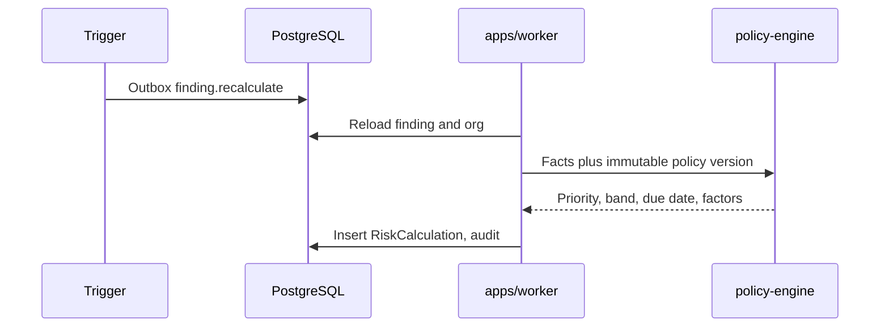

# Risk policy

**Status.** [ADR 0047](../adr/0047-controlled-priority-activation.md) is Accepted and composed in the API process. [ADR 0048](../adr/0048-controlled-remediation-queue.md) is Accepted and composed as owner and admin `GET /remediation-queue`. [ADR 0049](../adr/0049-append-only-priority-review.md) is Accepted and composed as owner `POST /findings/:findingId/priority-reviews`. Deliberate calculation is an owner API command. The worker diagram below is not that composition. A manual override does not insert a **RiskCalculation**. A priority review is not **RiskAcceptance**, and it does not change queue rank. `manual_override` and `manual_recalc` stay rejected. The production allowlist admits V-0001, outcome `validated_with_residuals`. Calculation returns 503 until an operator publishes that builtin in the deployment. Admission does not publish a row. Automatic recalculation, RemediationTask, and verification stay unavailable. See [current state](../project/current-state.md).

This is the canonical design for explainable, versioned **priority** calculation. Engine decision: [ADR 0012](../adr/0012-explainable-policy-engine.md). Numerical policy and engine contract: [ADR 0045](../adr/0045-deterministic-p1-p4-priority-policy.md) (Accepted 2026-11-04) and the Session 2 engine in `packages/policy-engine`. The API process composes that engine through `PriorityEnginePort`. The development seed and the deployment-local publication command can write builtin `patchpilot.builtin.v0` version 2 from `BUILTIN_PRIORITY_POLICY_DEFINITION`. The publication command admits the V-0001 pair and still refuses any other pair. The calculation use case appends **RiskCalculation** rows. Current selection is read-time latest by `calculatedAt`, then `id`. `Finding.currentRiskCalculationId` and `Finding.dueAt` stay null. The independent priority section is on `/findings/:findingId`. That section reports policy unavailable until an operator publishes the admitted builtin in that deployment ([current state](../project/current-state.md)).

Until a later ADR splits the terms, **priority** and **risk score** mean the same stored ranking ([glossary](../product/glossary.md), [OD-7](open-decisions.md)).

AI must not set authoritative scores. Optional AI, if added later, may only draft non-authoritative text ([ADR 0017](../adr/0017-optional-ai-user-credentials.md)).

## Observed facts versus calculated values

| Observed facts (inputs) | Calculated conclusions (outputs) |
| --- | --- |
| Source severity / CVSS when provided | **Priority** integer |
| KEV listed boolean and catalog identity at enrichment time | **Priority band** |
| Asset environment `sensitivityClass` | Rank order among findings |
| Asset **business criticality** | **Due-date recommendation** (calendar days; not a SLA contract) |
| Internet exposure vocabulary | **Escalation recommendation** (boolean/label; not auto-notify in MVP) |
| Asset data classification vocabulary | |
| Direct vs transitive when the SBOM recorded it | |
| Fix available / affected range from OSV when present | |
| Finding age (`firstObservedAt` vs now, frozen in tests) | |
| Advisory withdrawn flag | |
| Policy version identifier used | Copied onto the calculation as evidence |

The engine must not treat **RemediationTask** state as a fact about the component. Completing work does not change inputs until a new SBOM observation exists.

Missing evidence is recorded as `unknown` or `unavailable` with **zero** contribution. It must not be treated as "not internet facing" or "not KEV."

Compensating controls are not an engine input. The ADR 0045 fact input rejects a `compensating_control` key and any remediation-task field. A future policy may add a named factor only through a new ADR and policy version, and only if the **Evidence** row matches a defined schema.

**Risk acceptance** does not rewrite **RiskCalculation**. It changes finding workflow state and default queue filters.

**Manual priority override** is not a **RiskCalculation**. [ADR 0049](../adr/0049-append-only-priority-review.md) records acceptance and correction as append-only reviews of one immutable calculation. A review does not insert a calculation, and the calculation writer continues to reject `manual_override` and `manual_recalc`. The calculation writer records `initial`, `rescan`, `intel_refresh`, `policy_change`, and `asset_change`.

## Vulnerability severity versus remediation priority

| Term | Meaning |
| --- | --- |
| Vulnerability severity | Observed (or source-provided) severity on the intelligence record. Copied onto **RiskCalculation** as `severitySnapshot`. |
| Remediation **priority** | PatchPilot's calculated ranking for **this** finding under **this** policy version, including environment and KEV enrichment factors. |

UI, exports, and logs must not label priority as "CVSS" or as "exploitability proof." KEV is a factor, not proof of exploitation in the user's environment.

## Policy versions

- Built-in policy key: `patchpilot.builtin.v0`. Shared table: `scope = builtin` with null `organizationId`, or `scope = organization` with a required organization.
- Versions are monotonic integers per key. Published **RiskPolicy.definition**, identity, and `publishedAt` are immutable. Published rows cannot be deleted. The only allowed published-status change is `published` → `retired`. Organization policies may record `createdByMembershipId` from the same organization, including after that membership is revoked. Built-in policies have no membership creator.
- Each **RiskCalculation** stores `riskPolicyId`, `policyVersion`, `policyDefinitionSha256` of the published definition, intel source record ids, **priority**, **priorityBand**, **dueDateRecommendationDays**, **escalationRecommendation**, `inputFingerprint`, and the full **contributingFactors** object used. Re-running the engine on those stored inputs plus the hashed definition must yield the same **priority** (and the same stored band/due-date/escalation).
- Application release version and policy version are independent. Release notes must mention policy version when scoring behavior changes.

## Contributing factors

Every calculation persists the **full set** of factors the engine received, including those with zero contribution and those marked `unknown` or `unavailable`.

The engine emits exactly 10 factor rows in catalog order, each with `factorId`, `ordinal`, `inputState`, `observedValue`, `normalizedPercent`, `weight`, `contributionCenti`, `status`, and a closed `explanationCode`, plus two rule rows. Free-text notes are not used. The row contract is [ADR 0045](../adr/0045-deterministic-p1-p4-priority-policy.md) section 6. The v2 factors document is the domain type `RiskCalculationFactorsV2Json` (`schemaVersion` 2). It stores those rows together with provenance sources the engine does not see. The numbers stay in [ADR 0045](../adr/0045-deterministic-p1-p4-priority-policy.md) and `packages/policy-engine`.

Factors are the explanation. Do not persist only the final number.

## Ranking explanation (why A is above B)

The API must be able to compare two findings in the same organization by:

1. Same policy version (if versions differ, say so first).
2. Ordered factor contributions (highest absolute contribution first).
3. Deterministic tie-breakers. ADR 0045 section 5 fixes them: priority, then escalation, then KEV listed, then source-severity percent, then the caller's `Finding.firstObservedAt` and `Finding.id`. The engine comparator returns `incomparable` across policy keys.

A comparison response is a **calculated** artifact. It cites stored factors; it does not call an LLM.

The remediation queue in [ADR 0048](../adr/0048-controlled-remediation-queue.md) is the caller of `compareForRemediationQueue`. A Finding is ranked only when its latest calculation uses the published validated builtin definition hash and the injected engine version. Any other hash or engine version is `incomparable` and is not placed on the ranked ordering. A Finding with no calculation is not treated as P4 and is not appended below the ranked section. The three sections are paginated separately. A priority review never changes that order.

## Recalculation without erasure

The uncomposed writer inserts a new **RiskCalculation** in the same database transaction that locks the Finding and reads facts, KEV membership, and the selected policy. On the first row it records `initial`. A later row records `policy_change` when the policy definition hash changes, `intel_refresh` when the KEV fact changes, `asset_change` when only asset context changes, and `rescan` otherwise. The schema enum also contains `manual_recalc` and `manual_override` for later design.

Never UPDATE factor blobs or priority in place. History remains queryable. Users can diff two calculations to see why a score changed. Current selection is read-time: the latest row by `calculated_at`, then `id`. `Finding.currentRiskCalculationId` and `Finding.dueAt` stay null. No migration selects the current row.

The diagram is not the composition [ADR 0047](../adr/0047-controlled-priority-activation.md) proposes. That proposal keeps deliberate calculation in the API process and reserves worker injection for a future automatic-recalculation ADR. The current uncomposed writer is the domain calculation use case. API, worker, and web do not construct it, and it emits no Outbox event.

If the diagram is not rendered: the figure is the historical worker sketch. [ADR 0047](../adr/0047-controlled-priority-activation.md) proposes the API process instead. The current uncomposed writer inserts a new row and emits no Outbox event.

## Organization overrides

An organization `admin`/`owner` may publish an override **RiskPolicy** (tenant-owned) that clones the builtin factor catalog and changes weights within validated bounds. ADR 0045 section 8 sets those bounds and lists what cannot be overridden: only weights may change, the sum stays 100, and catalog, normalization, thresholds, due days, and both KEV rules are fixed. `validatePolicyOverride` enforces this. An uncomposed publisher can insert a new organization version when `validatePolicyOverride` accepts a weights-only document. It writes `risk_policy.published` only when that insert commits. API, worker, and web do not construct it. A manual priority override remains outside the engine. [ADR 0049](../adr/0049-append-only-priority-review.md) stores that judgment as a review, not as a **RiskCalculation**.

Rules:

- Override applies only to **new** calculations after `publishedAt`.
- Historical calculations keep their policy version.
- Disable override → later calculations use builtin current version; history unchanged.
- Overrides cannot add AI, cannot fetch URLs, and cannot drop provenance fields.
- Publishing emits **AuditEvent** `risk_policy.published`.

## Engine isolation

`packages/policy-engine` is deterministic, pure, and side-effect free. Given the same facts and definition, tests must get the same priority.

It does not import Prisma, HTTP, AI SDKs, `@patchpilot/domain`, `@patchpilot/config`, or `node:*` modules. It has zero runtime dependencies and reads no clock or random source. A package-boundary test and package-local lint rules enforce this.

## Built-in policy

The built-in factor catalog, weights, normalization tables, bands, due-date recommendations, KEV rules, and explanation codes are defined by [ADR 0045](../adr/0045-deterministic-p1-p4-priority-policy.md). The engine exports them as the deep-frozen `BUILTIN_PRIORITY_POLICY_DEFINITION` (policy key `patchpilot.builtin.v0`, `schemaVersion` 2). This document does not restate the numbers; the ADR and the golden tests in `packages/policy-engine` are the reference.

The earlier illustrative sketch in this section (contribution ideas, "~100 capped", and the two example Findings) is superseded. ADR 0045 adopts the sketch's thresholds and due days, rejects capping in favor of rejection, and reproduces the two example Findings as golden cases: Finding A is priority 80 (P1) and Finding B is priority 50 (P3).

**Weights and thresholds are an initial operator policy, not universal security truth** ([risk register](../security/risk-register.md) R13). V-0001 records `validated_with_residuals`. They can change only via a new policy version. Scoring, the controlled queue, and priority review stay inactive in a deployment until an operator publishes the admitted pair there. Automatic recalculation, RemediationTask, and verification stay unavailable.

The development seed entrypoint publishes `patchpilot.builtin.v0` version 2 from `BUILTIN_PRIORITY_POLICY_DEFINITION`. Version 1 remains the empty placeholder and fails v2 validation by design. `seedDevelopmentData` skips version 2 unless `builtinPriorityDefinition` and `canonicalJson` are passed. The numbers stay in the engine and in [ADR 0045](../adr/0045-deterministic-p1-p4-priority-policy.md).

Unknown and unavailable evidence never subtracts risk.

## Incorrect prioritization as a product risk

A scoring bug is fixed by publishing a **new policy version** and recalculating. It is not fixed by silently rewriting history. See [release principles](../development/release-principles.md).

## Related documents

- [Finding lifecycle](finding-lifecycle.md)
- [Vulnerability intelligence](vulnerability-intelligence.md)
- [Audit model](audit-model.md)
